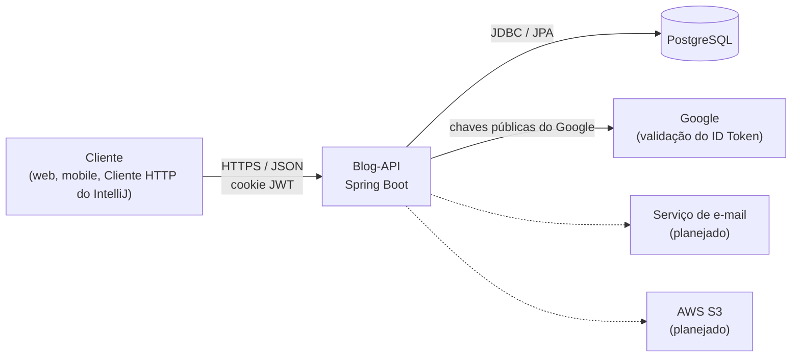
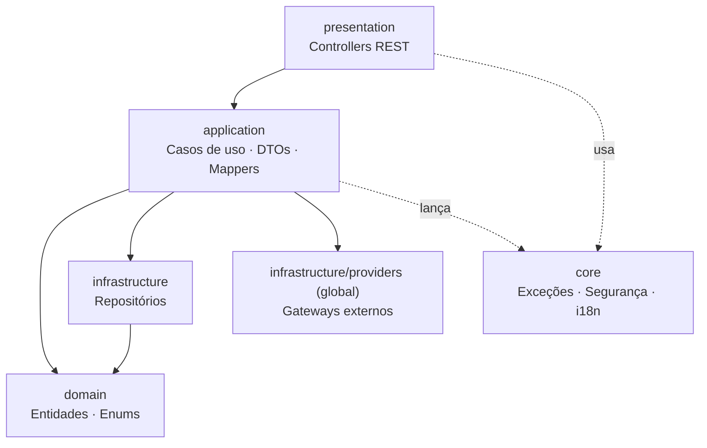
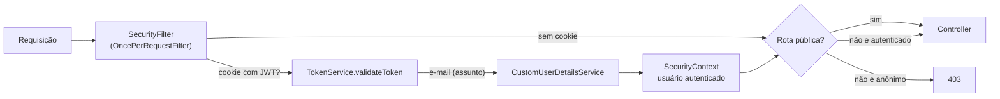
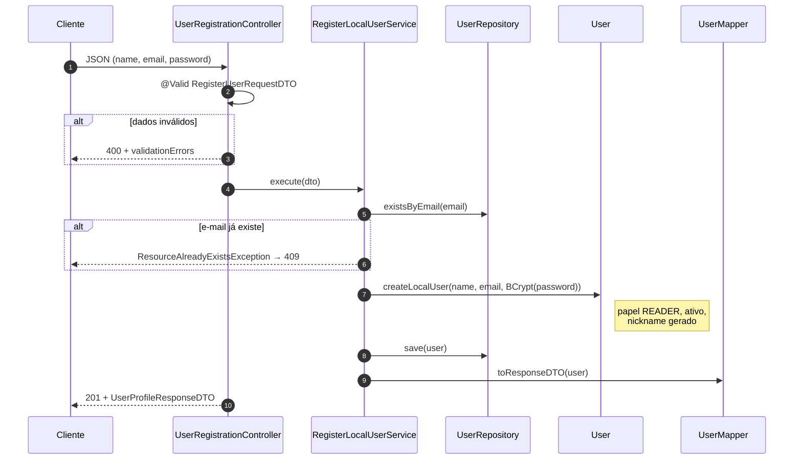
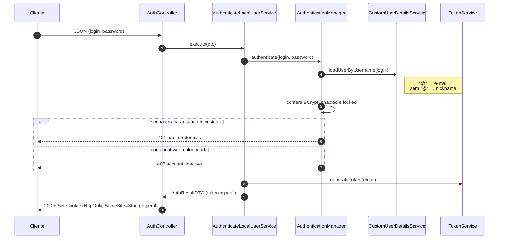
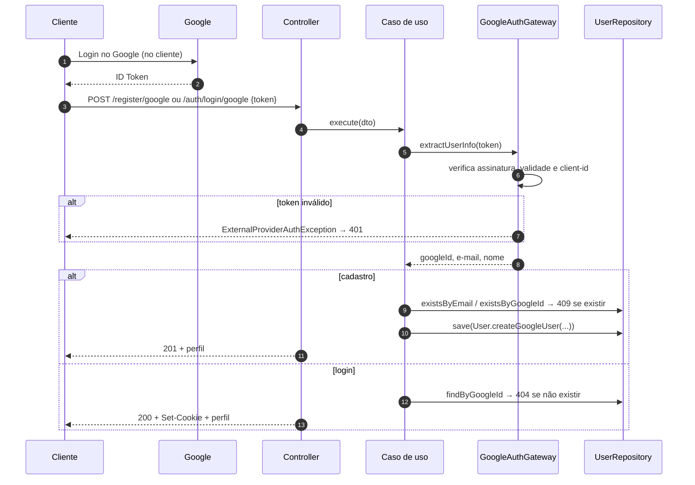
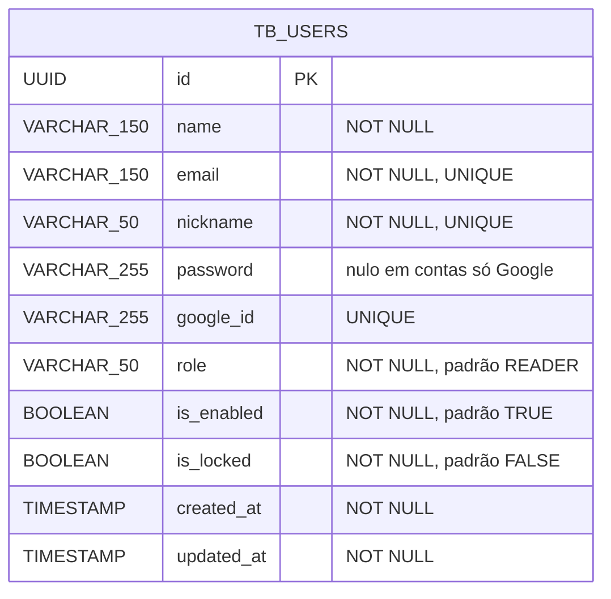
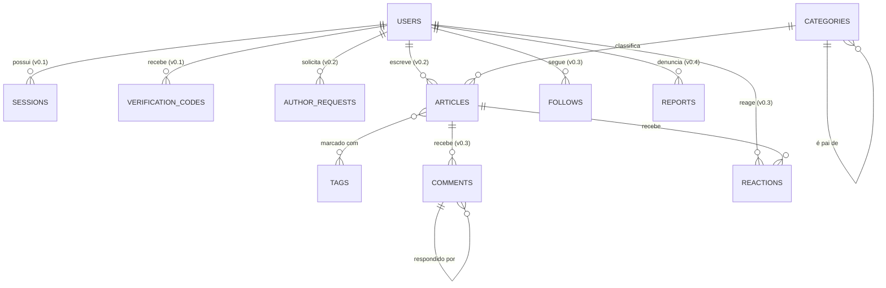
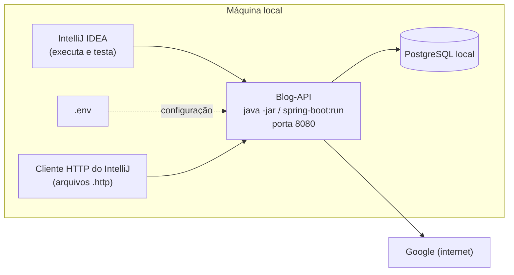

# Documento de Arquitetura de Software

## 1. Introdução

### 1.1 Propósito
Este documento descreve a arquitetura do Blog-API: como o sistema é dividido, como as partes se comunicam, como os dados são organizados, como a segurança e os erros são tratados, e quais princípios guiam a evolução do código. Ele serve para quem precisa entender, manter ou estender o sistema.

### 1.2 Escopo
Cobre a API REST como um todo: a estrutura de código, os componentes transversais (segurança, exceções, internacionalização), os fluxos de execução, o modelo de dados, as integrações externas e o ambiente de execução. As justificativas de cada escolha estão no [Decisões.md](Decisões.md), e o que o sistema deve fazer está em [Requisitos.md](Requisitos.md).

### 1.3 Convenções dos diagramas
Os diagramas usam **Mermaid**, que o GitHub desenha automaticamente. Os itens marcados como *(planejado)* ainda não existem no código.

---

## 2. Objetivos e restrições arquiteturais

### 2.1 Objetivos (atributos de qualidade)

| Atributo | O que significa aqui | Como a arquitetura atende |
|---|---|---|
| **Segurança** | Proteger contas, sessões e dados. | Spring Security stateless, JWT em cookie `HttpOnly`, BCrypt, rotas protegidas por padrão, segredos fora do código. |
| **Manutenibilidade** | Mudar uma parte sem quebrar outras. | Código por funcionalidade, camadas com dependências em um único sentido, casos de uso pequenos. |
| **Testabilidade** | Testar cada parte isoladamente. | Injeção de dependências por construtor, gateways para serviços externos, DTOs simples, um teste por classe. |
| **Evolução** | Adicionar módulos sem reescrever a base. | Monólito modular: cada módulo novo replica a mesma estrutura de camadas. |
| **Padronização** | Respostas previsíveis para os clientes. | DTOs obrigatórios, formato único de erro e mensagens traduzidas. |

### 2.2 Restrições
- Java 25, Spring Boot 4, Maven, PostgreSQL e Flyway.
- Sem Docker: a aplicação e o banco rodam localmente.
- Só API REST: não há interface própria.
- Repositório público: nenhum segredo pode estar no código.

---

## 3. Visão de contexto



| Elemento | Papel |
|---|---|
| **Cliente** | Qualquer aplicação que consome a API. Envia JSON e guarda o cookie de autenticação. |
| **Blog-API** | Recebe as requisições, aplica as regras de negócio e persiste os dados. |
| **PostgreSQL** | Guarda usuários e, no futuro, artigos, comentários, sessões etc. |
| **Google** | Fornece as chaves públicas usadas para validar a assinatura dos ID Tokens. |
| **E-mail** *(planejado)* | Envia códigos de ativação e de recuperação de senha. |
| **AWS S3** *(planejado)* | Armazena avatares e capas de artigos. |

---

## 4. Estilo arquitetural

### 4.1 Monólito modular
O sistema é uma **única aplicação** (um único processo e um único banco), dividida internamente em **módulos de negócio** independentes: `user`, e no futuro `article`, `social` e `moderation`. Essa abordagem tem a simplicidade de um monólito (um deploy, transações locais, sem rede entre módulos) e organiza o código como se fossem serviços separados, o que facilitaria uma eventual divisão no futuro.

### 4.2 Pragmatic Clean Architecture
Dentro de cada módulo, o código segue a **Clean Architecture**: as regras de negócio ficam no centro e não dependem de detalhes técnicos. Ela é aplicada de forma **pragmática**, ou seja, com concessões conscientes para evitar código cerimonial:

| Clean Architecture "pura" | Versão pragmática adotada | Motivo |
|---|---|---|
| Entidades de domínio sem anotações de framework. | As entidades de domínio **são** entidades JPA (`@Entity`). | Evita duplicar cada entidade (domínio + persistência) e os mapeamentos entre elas. |
| Interfaces (portas) para todo repositório. | Os repositórios Spring Data são usados diretamente pelos casos de uso. | O Spring Data já é uma interface; uma camada extra não traria ganho real. |
| Casos de uso sem framework. | Os casos de uso são `@Service`, com `@Transactional`. | Aproveita a injeção de dependências e o controle de transações do Spring. |
| Gateways para tudo que é externo. | **Mantido:** serviços externos (Google, e-mail, S3) sempre atrás de um gateway. | São a parte mais instável e mais difícil de testar. |

### 4.3 Camadas de um módulo



| Camada | Responsabilidade | Pode depender de | Não pode |
|---|---|---|---|
| **presentation** | Receber a requisição HTTP, validar o DTO (`@Valid`), chamar **um** caso de uso e devolver a resposta (status, cabeçalhos, corpo). | application, core | Conter regra de negócio, acessar repositórios, montar respostas de erro. |
| **application** | Orquestrar a ação de negócio: buscar dados, aplicar regras, salvar e converter para DTO. | domain, infrastructure, gateways, core | Conhecer HTTP (status, cookies, cabeçalhos). |
| **domain** | Representar o negócio: entidades, estados válidos, fábricas e regras internas da entidade. | — (só JPA e Lombok, pela abordagem pragmática) | Depender de outras camadas. |
| **infrastructure** | Persistência (Spring Data) do módulo. | domain | Conter regra de negócio. |

**Regra entre módulos:** um módulo não acessa o repositório de outro. Se `article` precisar de um dado de `user`, ele chama um caso de uso de `user`.

---

## 5. Estrutura de pacotes

```text
br.com.blog
├── BlogApiApplication.java              # Ponto de entrada do Spring Boot
│
├── core/                                # Transversal a todos os módulos
│   ├── config/
│   │   └── I18nConfiguration            # Idioma pelo Accept-Language (padrão pt-BR)
│   ├── exceptions/
│   │   ├── GlobalExceptionHandler       # Converte exceções em respostas HTTP
│   │   ├── ErrorResponseDTO             # Formato único de erro
│   │   ├── domain/                      # Erros de regra de negócio
│   │   │   ├── DomainException          #   base abstrata (chave i18n + argumentos)
│   │   │   ├── BusinessRuleException    #   → 422
│   │   │   ├── ResourceNotFoundException      → 404
│   │   │   └── ResourceAlreadyExistsException → 409
│   │   └── infrastructure/              # Erros técnicos ou de terceiros
│   │       ├── InfrastructureException  #   base abstrata (chave i18n + causa)
│   │       ├── ExternalProviderAuthException  → 401
│   │       └── SecurityInfrastructureException → 500
│   └── security/
│       ├── config/SecurityConfig        # Cadeia de filtros, rotas públicas, BCrypt
│       ├── jwt/TokenService             # Gera e valida o JWT
│       ├── jwt/SecurityFilter           # Lê o cookie e autentica cada requisição
│       └── userdetails/                 # Ponte entre User e o Spring Security
│           ├── CustomUserDetails
│           └── CustomUserDetailsService # Busca por e-mail ou nickname
│
├── infrastructure/providers/            # Serviços externos (gateways)
│   └── google/
│       ├── GoogleAuthConfig             # Verificador de ID Token com o client-id
│       └── GoogleAuthGateway            # Valida o token e extrai id, e-mail e nome
│
└── modules/
    └── user/
        ├── domain/
        │   ├── models/User              # Entidade + fábricas createLocalUser/createGoogleUser
        │   └── enums/UserRole           # READER, AUTHOR, MODERATOR, ADMIN
        ├── application/
        │   ├── usecases/auth/           # AuthenticateLocalUserService, AuthenticateGoogleUserService
        │   ├── usecases/registration/   # RegisterLocalUserService, RegisterGoogleUserService
        │   ├── dtos/auth/               # LoginRequestDTO, GoogleAuthRequestDTO
        │   ├── dtos/auth/internal/      # AuthResultDTO, GoogleUserInfoDTO (nunca saem na resposta)
        │   ├── dtos/registration/       # RegisterUserRequestDTO
        │   ├── dtos/shared/             # UserProfileResponseDTO
        │   └── mappers/UserMapper       # User → UserProfileResponseDTO
        ├── infrastructure/persistence/
        │   └── UserRepository           # Spring Data JPA
        └── presentation/controllers/
            ├── auth/AuthController                      # /api/v1/auth
            └── registration/UserRegistrationController  # /api/v1/register
```

Os módulos futuros (`article`, `social`, `moderation`) seguem exatamente a mesma estrutura.

### 5.1 Recursos (`src/main/resources`)

| Caminho | Conteúdo |
|---|---|
| `application.properties` | Configuração da aplicação. Valores sensíveis vêm do `.env`. |
| `db/migration/` | Migrations do Flyway (`V1__create_table_users.sql`, …). |
| `i18n/messages*.properties` | Mensagens: padrão, `pt_BR` e `en`. |

---

## 6. Componentes transversais (`core`)

### 6.1 Segurança



- **`SecurityConfig`:**
  - CSRF desativado (API stateless com cookie `SameSite=Strict`);
  - sessão `STATELESS`;
  - rotas públicas declaradas em `PUBLIC_ROUTES` (`/api/v1/register/**` e `/api/v1/auth/login/**`), todo o resto exige autenticação;
  - o `SecurityFilter` é registrado antes do filtro padrão de usuário e senha;
  - expõe o `PasswordEncoder` (BCrypt) e o `AuthenticationManager`.
- **`TokenService`:**
  - gera o JWT com HMAC256, segredo de `api.security.token.secret`, emissor = `spring.application.name`, assunto = e-mail e expiração = `api.security.token.expiration`;
  - na validação, devolve o assunto, ou uma string vazia se o token for inválido. Assim a requisição segue anônima e é barrada pela autorização, se a rota for protegida.
- **`SecurityFilter`:** procura o cookie de nome `api.security.token.name`, valida o token, carrega o usuário e preenche o `SecurityContext`.
- **`CustomUserDetailsService`:** se o login contém `@`, busca por e-mail; senão, por nickname.
- **`CustomUserDetails`:** expõe ao Spring Security o papel (`ROLE_*`), a senha (hash), o e-mail como nome de usuário e os estados `enabled` e `locked`. O Spring usa esses estados para recusar contas inativas no login local.
- **`@EnableMethodSecurity`:** está habilitado para usar `@PreAuthorize("hasRole('ADMIN')")` nos casos que exigem papel.

### 6.2 Exceções e respostas de erro

Toda exceção de negócio ou técnica carrega uma **chave de mensagem** (e argumentos opcionais). O `GlobalExceptionHandler` (`@RestControllerAdvice`) traduz a chave para o idioma da requisição e monta o `ErrorResponseDTO`.

| Exceção | Origem | Status |
|---|---|---|
| `BusinessRuleException` | Regra de negócio violada | 422 Unprocessable Content |
| `ResourceAlreadyExistsException` | Conflito de unicidade | 409 Conflict |
| `ResourceNotFoundException` | Recurso inexistente | 404 Not Found |
| `ExternalProviderAuthException` | Token externo inválido (Google) | 401 Unauthorized |
| `InfrastructureException` (demais) | Falha técnica (ex. geração de token) | 500 Internal Server Error |
| `MethodArgumentNotValidException` | DTO inválido (`@Valid`) | 400 + `validationErrors` |
| `HttpMessageNotReadableException` | JSON ausente ou malformado | 400 |
| `BadCredentialsException` | Login incorreto | 401 |
| `DisabledException` / `LockedException` | Conta inativa ou bloqueada | 403 |
| `AccessDeniedException` | Papel insuficiente | 403 |
| `NoResourceFoundException` | Rota inexistente | 404 |
| `HttpRequestMethodNotSupportedException` | Método HTTP errado | 405 |
| `Exception` (qualquer outra) | Erro inesperado | 500, com mensagem genérica |

**Por que duas famílias:** as exceções de **domínio** representam situações previstas pelo negócio, e a mensagem pode ser mostrada ao usuário. As de **infraestrutura** representam falhas técnicas: elas preservam a **causa original** para o log, mas o cliente recebe só uma mensagem genérica.

### 6.3 Internacionalização
- O `I18nConfiguration` define um `AcceptHeaderLocaleResolver`, com `pt-BR` como idioma padrão.
- As mensagens ficam em `i18n/messages.properties` (padrão), `messages_pt_BR.properties` e `messages_en.properties`.
- As chaves seguem o padrão `error.<area>.<motivo>`, e as de validação seguem `error.validation.<area>.<campo>.<regra>`.
- Se uma chave não existir, o handler devolve a própria chave, o que facilita encontrar mensagens faltando.

---

## 7. Fluxos principais

### 7.1 Cadastro local — `POST /api/v1/register`



### 7.2 Login local — `POST /api/v1/auth/login`



### 7.3 Cadastro e login com Google



### 7.4 Requisição autenticada (qualquer rota protegida)
1. O cliente envia a requisição com o cookie do JWT. O navegador faz isso sozinho; no Cliente HTTP do IntelliJ, o cookie é reaproveitado entre requisições.
2. O `SecurityFilter` valida o token e carrega o usuário.
3. O Spring Security confere se a rota exige autenticação e, quando houver `@PreAuthorize`, o papel.
4. O controller recebe a requisição. O usuário autenticado está disponível no `SecurityContext`.

---

## 8. Modelo de dados

### 8.1 Atual



### 8.2 Planejado



### 8.3 Convenções do banco
- **Tabelas** com o prefixo `tb_` e nome no plural, em inglês (`tb_users`).
- **Chave primária** `id` do tipo **UUID**, gerada pela aplicação. Não expõe a quantidade de registros, como faria um número sequencial.
- **Auditoria** com `created_at` e `updated_at` em toda tabela, preenchidos pelo Hibernate (`@CreationTimestamp` e `@UpdateTimestamp`).
- **Booleanos** com o prefixo `is_` (`is_enabled`).
- **Enums** guardados como texto (`EnumType.STRING`), que é legível e não quebra se a ordem mudar.
- **Migrations:**
  - só pelo Flyway, nomeadas `V<n>__descricao.sql`;
  - uma migration aplicada nunca é editada;
  - o Hibernate roda com `ddl-auto=validate`, ou seja, só confere se as entidades batem com as tabelas e a aplicação não sobe se houver divergência.

---

## 9. Desenho da API

| Aspecto | Convenção |
|---|---|
| **Prefixo e versão** | `/api/v1/...`. Uma mudança incompatível cria `/api/v2`. |
| **Formato** | JSON, com `Content-Type: application/json`. |
| **Idioma** | Cabeçalho `Accept-Language` (`pt-BR` ou `en`). |
| **Autenticação** | Cookie `HttpOnly` com o JWT, definido no login. |
| **Entrada e saída** | Sempre DTOs (`record`): `<Ação>RequestDTO` e `<Objeto>ResponseDTO`. Entidades nunca saem pela API. |
| **Validação** | Bean Validation no DTO, com `@Valid` no controller e mensagens como chaves de i18n. |
| **Códigos de sucesso** | `200` (consulta ou ação), `201` (criação), `204` (remoção ou ação sem corpo). |
| **Erros** | Formato único `ErrorResponseDTO` (seção 6.2). |
| **Paginação** *(planejado)* | Parâmetros `page` e `size`, com tamanho máximo de página. |

### 9.1 Endpoints atuais

| Método | Rota | Corpo | Sucesso | Erros |
|---|---|---|---|---|
| POST | `/api/v1/register` | `RegisterUserRequestDTO` | 201 + perfil | 400, 409 |
| POST | `/api/v1/register/google` | `GoogleAuthRequestDTO` | 201 + perfil | 400, 401, 409 |
| POST | `/api/v1/auth/login` | `LoginRequestDTO` | 200 + cookie + perfil | 400, 401, 403 |
| POST | `/api/v1/auth/login/google` | `GoogleAuthRequestDTO` | 200 + cookie + perfil | 400, 401, 404 |

---

## 10. Integrações externas

Todo serviço externo fica **atrás de um gateway** em `infrastructure/providers/<provedor>/`. Os casos de uso dependem só do gateway, que é simulado nos testes. Trocar de provedor (ex. de SMTP para Amazon SES) afeta só o gateway.

| Integração | Gateway | Situação | Detalhes |
|---|---|---|---|
| **Google Sign-In** | `GoogleAuthGateway` | Implementada | Usa o `GoogleIdTokenVerifier`, configurado com o `client-id` (`api.security.google.client-id`), para validar assinatura, validade e destinatário. Devolve `GoogleUserInfoDTO` (id, e-mail e nome). Falhas viram `ExternalProviderAuthException` (401). |
| **E-mail** | `EmailGateway` *(planejado)* | v0.1 | Envio de códigos com templates traduzidos. |
| **Armazenamento** | `StorageGateway` *(planejado)* | v0.2 | Upload e remoção de imagens no AWS S3. |

---

## 11. Configuração e ambiente

### 11.1 Configuração
- O `application.properties` importa o arquivo `.env` da raiz (`spring.config.import=optional:file:.env[.properties]`). O `.env` fica fora do Git.
- Propriedades principais:

  | Propriedade | Uso |
  |---|---|
  | `spring.datasource.*` | Conexão com o PostgreSQL. |
  | `api.security.token.secret` | Segredo de assinatura do JWT. |
  | `api.security.token.expiration` | Validade do JWT, em milissegundos (`JWT_EXPIRATION`). |
  | `api.security.token.name` | Nome do cookie de autenticação. |
  | `api.security.google.client-id` | Client-id do OAuth do Google. |
  | `spring.jpa.hibernate.ddl-auto=validate` | O Hibernate só valida o esquema. |
  | `spring.flyway.enabled=true` | Aplica as migrations ao subir. |

### 11.2 Execução (implantação local)



Ainda não há perfil de produção. Quando houver, ele precisará de `Secure=true` nos cookies, `show-sql=false` e um segredo JWT forte.

---

## 12. Testes na arquitetura

A arquitetura foi pensada para que cada camada seja testada isoladamente:

| Camada | Tipo de teste |
|---|---|
| domain, DTOs, mappers, exceções | Unitário puro. |
| application (casos de uso) | Unitário com Mockito: repositórios e gateways simulados. |
| presentation (controllers) | `@WebMvcTest` com `MockMvc` e `SecurityConfig` real. |
| infrastructure (repositórios, migrations) | Integração com banco de teste *(planejado)*. |

Os testes ficam no mesmo pacote da classe testada. A estratégia completa está no [Plano_de_Testes.md](Testes/Plano_de_Testes.md).

---

## 13. Evolução planejada

| Versão | Mudança arquitetural |
|---|---|
| **v0.1** | Tabela de sessões, Refresh Token em cookie próprio, `EmailGateway`, tabela de códigos de verificação, springdoc-openapi (Swagger), perfis de configuração. |
| **v0.2** | Módulo `article` (artigos, categorias, tags), `StorageGateway` (S3), paginação, autorização por papel com `@PreAuthorize`. |
| **v0.3** | Módulo `social` (comentários, reações, seguidores, feed) e busca textual no PostgreSQL. |
| **v0.4** | Módulo `moderation` e 2FA TOTP no fluxo de login. |

---

## 14. Riscos e débitos técnicos

| Item | Descrição | Referência |
|---|---|---|
| Colisão de nickname | Pode gerar erro 500 no cadastro. | [Regras_de_Negócio.md](Regras_de_Negócio.md#5-divergências-conhecidas) · D1 |
| Login Google sem checar o estado da conta | Contas bloqueadas conseguiriam entrar pelo Google. | D3 |
| `email_verified` não conferido | Um e-mail não verificado no Google ocuparia a conta. | D5 |
| Cookie com `Secure=false` e validade fixa | Inadequado para produção. | D4 · RNF-004 |
| CSRF desativado | Mitigado pelo `SameSite=Strict`; reavaliar com o Refresh Token. | RNF-002 |
| Sem Swagger | A Definição de Pronto exige Swagger. | RNF-020 |
| Cobertura de testes | 6 de 35 classes têm teste. | RNF-026 |
| Sem perfil de produção | Configurações de desenvolvimento valem para tudo. | — |
