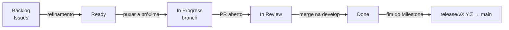

# Processo de Desenvolvimento

Este documento explica como o Blog-API é construído: o método de trabalho (um Kanban simples), os artefatos de Engenharia de Software produzidos em cada etapa, as ferramentas usadas e o caminho completo que uma ideia percorre até virar código na `develop`.

Em resumo, o trabalho flui por um quadro Kanban no GitHub Projects, uma issue de cada vez, e as entregas são agrupadas em versões (Milestones). Junto com o código, uma documentação de Engenharia de Software (definição, requisitos, regras de negócio, arquitetura, plano e relatórios de testes) explica o produto e mantém a rastreabilidade entre o que foi pedido, o que foi construído e o que foi testado.

---

## 1. Por que Kanban com documentação

O projeto é desenvolvido por uma pessoa só, com o apoio de uma IA. Métodos como o Scrum pressupõem uma equipe, com papéis separados, Sprints de duração fixa e reuniões de planejamento, revisão e retrospectiva. Para uma pessoa, isso vira burocracia sem ganho (ver a decisão D-015 em [Decisões.md](Decisões.md)).

O Kanban é mais leve. Ele tem só três ideias centrais:

1. tornar o trabalho visível em um quadro, com uma coluna para cada etapa;
2. limitar o trabalho em andamento, terminando uma tarefa antes de começar outra;
3. puxar a próxima tarefa do topo da fila quando houver espaço.

A documentação continua importante, por três motivos:

1. Estudo: o projeto é um portfólio de Engenharia de Software. Os documentos mostram o raciocínio por trás do código: por que cada regra existe, como as partes se conectam e como a qualidade é verificada.
2. Continuidade: como o desenvolvimento é individual e pode ter pausas, os documentos guardam o contexto que, de outra forma, ficaria só na memória.
3. Rastreabilidade: cada requisito (RF) aponta para as regras de negócio (RN) que o detalham, que apontam para os testes que as comprovam e para as issues que as implementam. Assim dá para responder, a qualquer momento, "isto foi pedido? foi feito? foi testado?".

A documentação é viva: ela é atualizada no mesmo PR que muda o código (ver a Definição de Pronto). Ela não é escrita toda antes, como no modelo cascata, mas evolui junto com o produto, issue a issue.

---

## 2. Quem faz o quê

Todas as decisões são da autora. O Claude atua como assistente de desenvolvimento.

| Quem | Responsabilidade |
|---|---|
| Autora | Decide o que o produto deve ser e a ordem das tarefas, escreve ou aprova os critérios de aceite, revisa cada PR e faz todos os merges. |
| Claude (assistente de IA) | Implementa, testa e documenta, seguindo as regras do `CLAUDE.md`. |

O Claude abre branches e PRs e faz commits pequenos, mas nunca mescla, não instala nada sem aprovação, não altera configurações do repositório e não fecha uma issue que não cumpra todos os critérios de aceite.

---

## 3. Onde o trabalho vive

| Item | O que é | Onde fica |
|---|---|---|
| Visão do produto | O que o produto é, para quem e com que objetivos. | [Definição_do_Projeto.md](Definição_do_Projeto.md) |
| Backlog | A lista ordenada de tudo o que o produto pode vir a ter. | GitHub Issues, com os rótulos `type:*` e `module:*`, organizadas no quadro do GitHub Projects "Blog-API", que é privado. Ideias ainda imaturas entram como *draft items* no Projects. |
| Versões | Conjuntos de issues que, juntas, entregam um tema do produto. | Milestones do GitHub, descritos no [Roadmap.md](Roadmap.md). |
| Entregas | O código integrado e funcionando. | Os PRs mergeados na `develop`. Ao fim de um Milestone, um `release/vX.Y.Z` leva a versão para a `main`. |

---

## 4. Versões e issues

Dois conceitos de escopo convivem no projeto:

| Conceito | Representa | Exemplo |
|---|---|---|
| Milestone | Uma versão do produto com um tema (uma *release*). | `v0.1 – Identidade essencial` |
| Issue | Uma funcionalidade, um bug ou uma tarefa técnica. | `[Auth] Sessões: Refresh Token com rotação` |

Não há prazos fixos. Um Milestone termina quando todas as suas issues estão prontas. Uma issue deve ser pequena o bastante para caber em um único PR fácil de revisar. Se não couber, ela é quebrada em partes menores antes de começar.



---

## 5. Quadro do GitHub Projects

| Coluna | Significado | Quando a issue entra |
|---|---|---|
| Backlog | Ideia registrada, ainda não refinada. | Ao ser criada. |
| Ready | Atende à Definição de Preparado (seção 6.1) e pode ser começada. | Depois do refinamento. |
| In Progress | Branch criado e trabalho em andamento. | Ao criar o branch. |
| In Review | PR aberto, aguardando a revisão da autora. | Ao abrir o PR. |
| Done | PR mergeado e Definição de Pronto cumprida. | Automaticamente, pelo `Closes #N`. |

Regras do quadro:

- a coluna Ready é ordenada por prioridade, e a próxima issue é sempre a do topo;
- In Progress tem no máximo **uma** issue por vez, e In Review no máximo **duas**. Antes de começar algo novo, termina-se o que está aberto;
- um impedimento é registrado em um comentário na issue. Exemplo: "aguardando aprovação para baixar a dependência X".

---

## 6. Definição de Preparado e Definição de Pronto

### 6.1 Definição de Preparado (Definition of Ready)

Uma issue só vai para a coluna Ready se:

- [ ] tem um objetivo claro (o que entrega e por quê);
- [ ] tem critérios de aceite verificáveis;
- [ ] cita os requisitos e as regras que atende (RF-xxx, RN-xxx), e essas regras estão escritas no [Regras_de_Negócio.md](Regras_de_Negócio.md);
- [ ] tem as dependências resolvidas, ou elas estão antes dela na fila;
- [ ] é pequena o bastante para um único PR;
- [ ] tem rótulos de tipo e de módulo e está em um Milestone.

### 6.2 Definição de Pronto (Definition of Done)

Uma issue só é considerada entregue, e só então fechada, quando:

- [ ] o código compila sem erros nem warnings;
- [ ] existem os testes exigidos (teste unitário para toda classe e testes do tipo da classe: Mockito, `@WebMvcTest` etc.), e todos passam;
- [ ] os endpoints foram validados manualmente com arquivos `.http` no Cliente HTTP do IntelliJ;
- [ ] o README, o Swagger e os documentos de `docs/` foram atualizados (requisitos, regras, arquitetura, plano de testes);
- [ ] todos os critérios de aceite da issue foram cumpridos;
- [ ] o PR foi revisado e mergeado na `develop` pela autora.

O checklist é repetido no template de PR (`.github/pull_request_template.md`), para ser conferido em cada entrega.

---

## 7. Revisão ao fechar uma versão

Sem Sprints, não há reuniões periódicas. A única pausa para olhar para trás acontece ao fechar um Milestone:

1. rodar a suíte completa de testes e registrar um [Relatório de Testes](Testes/Relatórios/README.md);
2. executar os arquivos `.http` da versão e conferir os critérios de aceite das issues;
3. anotar o que funcionou, o que atrapalhou e o que mudar. Se a mudança for no processo, este documento é atualizado. Se for uma decisão de projeto, ela é registrada no [Decisões.md](Decisões.md);
4. reordenar o backlog conforme o que se aprendeu.

---

## 8. Etapas de Engenharia de Software e seus documentos

Cada etapa clássica da Engenharia de Software tem um documento correspondente. Essas etapas não acontecem uma vez só: elas se repetem um pouco para cada funcionalidade.

| Etapa | Pergunta que responde | Documento |
|---|---|---|
| Concepção | Por que o produto existe e para quem? | [Definição_do_Projeto.md](Definição_do_Projeto.md) |
| Requisitos | O que o sistema deve fazer, e com que qualidade? | [Requisitos.md](Requisitos.md) |
| Regras de negócio | Quais regras e restrições cada funcionalidade obedece? | [Regras_de_Negócio.md](Regras_de_Negócio.md) |
| Projeto (design) | Como o sistema é organizado por dentro? | [Arquitetura.md](Arquitetura.md) |
| Implementação | Código-fonte e convenções. | `src/` e `CLAUDE.md` |
| Verificação | Como garantir que funciona? | [Plano_de_Testes.md](Testes/Plano_de_Testes.md) e [Relatórios](Testes/Relatórios/README.md) |
| Evolução | Para onde o produto vai? | [Roadmap.md](Roadmap.md) |
| Decisões | Por que escolhemos assim? | [Decisões.md](Decisões.md) |
| Segurança operacional | Como proteger o repositório e a conta? | [Segurança.md](Segurança.md) |

### Rastreabilidade

```mermaid
flowchart LR
    V[Visão<br/>Definição do Projeto] --> RF[Requisito<br/>RF-xxx]
    RF --> RN[Regra de negócio<br/>RN-xxx]
    RF --> I[Issue #N]
    RN --> T[Teste<br/>@DisplayName cita RN]
    I --> PR[PR · Closes #N]
    PR --> T
    T --> REL[Relatório de testes]
```

---

## 9. Caminho de uma funcionalidade, do começo ao fim

1. Ideia: vira um *draft item* no Projects ou uma issue na coluna Backlog.
2. Refinamento:
   - o requisito é escrito ou atualizado no [Requisitos.md](Requisitos.md) (RF-xxx);
   - as regras são escritas no [Regras_de_Negócio.md](Regras_de_Negócio.md) (RN-xxx);
   - a issue ganha critérios de aceite, IDs e Milestone e vai para a coluna Ready.
3. Desenvolvimento (Git Flow):
   - a issue do topo da coluna Ready é puxada, e cria-se `feature/<nome>` a partir da `develop` (coluna In Progress);
   - os commits são curtos e em sequência: migration → entidade → DTOs → caso de uso → controller → testes → `.http` → documentação.
4. Pull Request: um PR por branch, com `Closes #N`, o checklist da Definição de Pronto e os IDs atendidos (coluna In Review). Os workflows do GitHub verificam o PR, por exemplo a ausência de links de sessão do Claude.
5. Revisão e merge: a autora revisa e faz o merge na `develop`. A issue fecha sozinha (coluna Done).
6. Release: ao fechar o Milestone, faz-se a revisão da seção 7, cria-se `release/vX.Y.Z` e faz-se o merge na `main` e na `develop`.

---

## 10. Ferramentas

| Ferramenta | Uso |
|---|---|
| IntelliJ IDEA | IDE, execução dos testes e Cliente HTTP (arquivos `.http`) para testes manuais. Não se usa Postman. |
| Git + GitHub Desktop | Versionamento e envio dos commits. |
| GitHub Issues e Projects | Backlog, versões e quadro Kanban. |
| GitHub CLI (`gh`) | Automação de issues, PRs e Projects pelo terminal. |
| GitHub Actions | Verificações automáticas nos PRs e nas issues. |
| Maven Wrapper (`mvnw`) | Build e testes pela linha de comando. |
| Claude Code | Assistente de desenvolvimento, que segue as regras do `CLAUDE.md`. |
