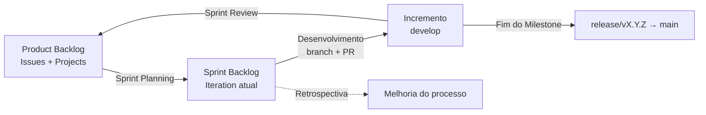

# Processo de Desenvolvimento

Este documento explica **como** o Blog-API é construído: o método de trabalho (Scrum adaptado a uma desenvolvedora), os artefatos de Engenharia de Software produzidos em cada etapa, as ferramentas usadas e o caminho completo que uma ideia percorre até virar código na `develop`.

> **Resumo:** o projeto usa **Scrum** para organizar o trabalho em ciclos curtos (Sprints) e entregar incrementos funcionais, combinado com uma **documentação de Engenharia de Software** (definição, requisitos, regras de negócio, arquitetura, plano e relatórios de testes) que explica o produto e mantém a rastreabilidade entre o que foi pedido, o que foi construído e o que foi testado.

---

## 1. Por que Scrum com documentação

O Scrum, sozinho, privilegia "software funcionando mais do que documentação abrangente". Isso não significa ausência de documentação: significa documentação **útil**. Neste projeto ela é útil por três motivos:

1. **Estudo:** o projeto é um portfólio de Engenharia de Software. Os documentos mostram o raciocínio por trás do código: por que cada regra existe, como as partes se conectam e como a qualidade é verificada.
2. **Continuidade:** como o desenvolvimento é individual e pode ter pausas, os documentos guardam o contexto que, de outra forma, ficaria só na memória.
3. **Rastreabilidade:** cada requisito (RF) aponta para as regras de negócio (RN) que o detalham, que apontam para os testes que as comprovam e para as issues que as implementam. Assim dá para responder, a qualquer momento, "isto foi pedido? foi feito? foi testado?".

A documentação é **viva**: é atualizada no mesmo PR que muda o código (ver a Definição de Pronto). Ela não é escrita toda antes, como no modelo cascata, mas evolui junto com o produto, Sprint a Sprint.

---

## 2. Papéis do Scrum

No Scrum tradicional existem três responsabilidades. Aqui, todas são exercidas pela autora, com o apoio de uma IA (Claude) como ferramenta de desenvolvimento.

| Papel | Responsabilidade | Como acontece no projeto |
|---|---|---|
| **Product Owner (PO)** | Define o que o produto deve ser e a ordem de prioridade do que será construído. | A autora mantém o Product Backlog (Issues), escreve as histórias e os critérios de aceite e decide a ordem nos Milestones. |
| **Scrum Master** | Garante que o processo seja seguido e remove impedimentos. | A autora, apoiada pelas regras automáticas: templates de issue e PR, checklist da Definição de Pronto, workflows do GitHub e o `CLAUDE.md`. |
| **Developers** | Constroem o incremento com qualidade. | A autora, com o Claude como assistente: ele implementa, testa e documenta, mas **nunca faz merge**. Toda mudança passa pela revisão e aprovação da autora no PR. |

**Limites do assistente de IA:** o Claude segue as regras do `CLAUDE.md`. Ele abre branches e PRs e faz commits pequenos, mas não mescla, não instala nada sem aprovação, não altera configurações do repositório e não fecha uma issue que não cumpra todos os critérios de aceite.

---

## 3. Artefatos do Scrum e onde eles vivem

| Artefato | O que é | Onde fica |
|---|---|---|
| **Meta do Produto** | O objetivo de longo prazo do produto. | [Definição_do_Projeto.md](Definição_do_Projeto.md), seção *Visão*. |
| **Product Backlog** | A lista ordenada de tudo o que o produto pode vir a ter. | **GitHub Issues** com os rótulos `type:*` e `module:*`, organizadas no quadro do **GitHub Projects "Blog-API"**, que é privado. Ideias ainda imaturas entram como *draft items* no Projects. |
| **Meta da Sprint** | O objetivo de uma Sprint, em uma frase. | Na descrição da *iteration* (Sprint) no Projects. |
| **Sprint Backlog** | As issues escolhidas para a Sprint e o plano para entregá-las. | Campo *Iteration* do Projects, preenchido com a Sprint atual. |
| **Incremento** | O resultado da Sprint, integrado e funcionando. | Os PRs mergeados na `develop` durante a Sprint. Ao fim de um Milestone, um `release/vX.Y.Z` leva o incremento para a `main`. |

### Compromissos de cada artefato

- **Product Backlog → Meta do Produto:** toda issue precisa contribuir para a visão descrita na Definição do Projeto.
- **Sprint Backlog → Meta da Sprint:** as issues da Sprint precisam, juntas, entregar a meta escolhida.
- **Incremento → Definição de Pronto:** só conta como entregue o que cumpre **todos** os itens da Definição de Pronto (seção 6).

---

## 4. Milestones, Sprints e versões

Três conceitos de tempo e escopo convivem no projeto:

| Conceito | Duração | Representa | Exemplo |
|---|---|---|---|
| **Milestone** | Várias Sprints | Uma **versão** do produto com um tema (uma *release*). | `v0.1 – Identidade essencial` |
| **Sprint** | 2 semanas *(proposta; ajustável)* | Um ciclo de trabalho com meta própria. | "Sprint 3: sessões com Refresh Token funcionando" |
| **Issue** | Cabe em uma Sprint | Uma história, bug ou tarefa técnica. | `[Auth] Sessões: Refresh Token com rotação` |

Um Milestone é a "entrega grande" do [Roadmap.md](Roadmap.md); as Sprints são os passos para chegar lá. Se uma issue não cabe em uma Sprint, ela é grande demais e deve ser quebrada em partes menores.



---

## 5. Eventos do Scrum (adaptados)

Os eventos foram adaptados a uma pessoa só. O objetivo de cada um continua o mesmo: inspecionar e adaptar.

### 5.1 Sprint Planning (início da Sprint)

- **Duração sugerida:** até 1 hora.
- **Entradas:** o Product Backlog ordenado e a capacidade da Sprint (quanto tempo a autora terá disponível).
- **O que se faz:**
  1. Definir a **Meta da Sprint** em uma frase.
  2. Escolher, do topo do backlog, as issues que entregam essa meta e que estão **Prontas para começar** (Definição de Preparado, seção 6.1).
  3. Estimar cada issue em pontos (seção 7) e conferir se o total cabe na capacidade.
  4. Preencher o campo *Iteration* das issues escolhidas.
- **Saída:** o Sprint Backlog e a Meta da Sprint registrados no Projects.

### 5.2 Daily (acompanhamento diário)

Sem uma equipe, não há reunião diária. Ela é substituída por uma **atualização curta do quadro** a cada dia de trabalho:

- mover as issues entre as colunas (*Todo → In Progress → In Review → Done*);
- registrar impedimentos em um comentário na issue. Exemplo: "aguardando aprovação para baixar dependência X".

### 5.3 Sprint Review (fim da Sprint)

- **O que se faz:** demonstrar para si mesma o que foi entregue, executando os arquivos `.http` no Cliente HTTP do IntelliJ, e conferir cada critério de aceite.
- **Saída:** as issues que cumprem a Definição de Pronto são fechadas. As que não cumprem voltam ao backlog com um comentário explicando o que falta. O Product Backlog é reordenado conforme o que se aprendeu.

### 5.4 Sprint Retrospective (fim da Sprint)

- **Perguntas:** o que funcionou? O que atrapalhou? O que mudar na próxima Sprint?
- **Saída:** no máximo 1 a 3 ações de melhoria. Se uma ação mudar o processo, este documento é atualizado. Se for uma decisão de projeto, ela é registrada no [Decisões.md](Decisões.md).

### 5.5 Backlog Refinement (contínuo)

A qualquer momento, as issues do topo do backlog são refinadas: ganham critérios de aceite, IDs de requisitos (RF) e regras (RN), estimativa e quebra em partes menores. Uma issue refinada atende à Definição de Preparado.

---

## 6. Definição de Preparado e Definição de Pronto

### 6.1 Definição de Preparado (Definition of Ready)

Uma issue só entra numa Sprint se:

- [ ] tem **objetivo** claro (o que entrega e por quê);
- [ ] tem **critérios de aceite** verificáveis;
- [ ] cita os **requisitos e regras** que atende (RF-xxx, RN-xxx), e essas regras estão escritas no [Regras_de_Negócio.md](Regras_de_Negócio.md);
- [ ] tem as **dependências** resolvidas, ou elas estão na mesma Sprint e vêm antes;
- [ ] está **estimada** e cabe em uma Sprint;
- [ ] tem **rótulos** de tipo e módulo e está em um **Milestone**.

### 6.2 Definição de Pronto (Definition of Done)

Uma issue só é considerada entregue, e só então fechada, quando:

- [ ] o código **compila sem erros nem warnings**;
- [ ] existem os **testes exigidos** (teste unitário para toda classe e testes do tipo da classe: Mockito, `@WebMvcTest` etc.), e todos passam;
- [ ] os endpoints foram **validados manualmente** com arquivos `.http` no Cliente HTTP do IntelliJ;
- [ ] **README, Swagger e documentos de `docs/`** foram atualizados (requisitos, regras, arquitetura, plano de testes);
- [ ] **todos os critérios de aceite** da issue foram cumpridos;
- [ ] o **PR foi revisado e mergeado na `develop`** pela autora.

O checklist é repetido no template de PR (`.github/pull_request_template.md`), para ser conferido em cada entrega.

---

## 7. Estimativas

As issues são estimadas em **Story Points**, na sequência de Fibonacci (1, 2, 3, 5, 8, 13), em um campo numérico do Projects. Os pontos medem o **esforço relativo** (complexidade, incerteza e volume de trabalho), não horas.

| Pontos | Referência |
|---|---|
| 1 | Ajuste trivial: uma mensagem de erro, um campo novo em um DTO. |
| 2 | Pequeno e conhecido: corrigir um bug isolado com teste. |
| 3 | Um caso de uso simples com controller, testes e `.http`. |
| 5 | Funcionalidade com várias regras ou uma tabela nova. Ex.: ativação de conta por e-mail. |
| 8 | Funcionalidade com integração externa ou muitas regras. Ex.: Refresh Token com rotação. |
| 13 | Grande demais: **deve ser quebrada** antes de entrar numa Sprint. |

**Velocidade:** ao fim de cada Sprint, somam-se os pontos das issues entregues. A média das últimas Sprints orienta quanto planejar na próxima.

---

## 8. Quadro do GitHub Projects

| Coluna | Significado | Quem move |
|---|---|---|
| **Backlog** | Ideia registrada, ainda não refinada. | — |
| **Ready** | Atende à Definição de Preparado. | Refinamento |
| **Todo** | Na Sprint atual, ainda não iniciada. | Sprint Planning |
| **In Progress** | Branch criado e trabalho em andamento. | Ao criar o branch |
| **In Review** | PR aberto, aguardando a revisão da autora. | Ao abrir o PR |
| **Done** | PR mergeado e Definição de Pronto cumprida. | Automático, pelo `Closes #N` |

---

## 9. Etapas de Engenharia de Software e seus documentos

Cada etapa clássica da Engenharia de Software tem um documento correspondente. No Scrum, essas etapas não acontecem uma vez só: acontecem um pouco em cada Sprint, para cada funcionalidade.

| Etapa | Pergunta que responde | Documento |
|---|---|---|
| **Concepção** | Por que o produto existe e para quem? | [Definição_do_Projeto.md](Definição_do_Projeto.md) |
| **Requisitos** | O que o sistema deve fazer, e com que qualidade? | [Requisitos.md](Requisitos.md) |
| **Regras de negócio** | Quais regras e restrições cada funcionalidade obedece? | [Regras_de_Negócio.md](Regras_de_Negócio.md) |
| **Projeto (design)** | Como o sistema é organizado por dentro? | [Arquitetura.md](Arquitetura.md) |
| **Implementação** | Código-fonte e convenções. | `src/` e `CLAUDE.md` |
| **Verificação** | Como garantir que funciona? | [Plano_de_Testes.md](Testes/Plano_de_Testes.md) e [Relatórios](Testes/Relatórios/README.md) |
| **Evolução** | Para onde o produto vai? | [Roadmap.md](Roadmap.md) |
| **Decisões** | Por que escolhemos assim? | [Decisões.md](Decisões.md) |
| **Segurança operacional** | Como proteger o repositório e a conta? | [Segurança.md](Segurança.md) |

### Rastreabilidade

```mermaid
flowchart LR
    V[Visão<br/>Definição do Projeto] --> RF[Requisito<br/>RF-xxx]
    RF --> RN[Regra de negócio<br/>RN-xxx]
    RF --> I[Issue #N]
    RN --> T[Teste<br/>@DisplayName cita RN]
    I --> PR[PR · Closes #N]
    PR --> T
    T --> REL[Relatório de testes]
```

---

## 10. Caminho de uma funcionalidade, do começo ao fim

1. **Ideia:** vira um *draft item* no Projects ou uma issue na coluna *Backlog*.
2. **Refinamento:**
   - o requisito é escrito ou atualizado no [Requisitos.md](Requisitos.md) (RF-xxx);
   - as regras são escritas no [Regras_de_Negócio.md](Regras_de_Negócio.md) (RN-xxx);
   - a issue ganha critérios de aceite, IDs, estimativa e Milestone → coluna *Ready*.
3. **Sprint Planning:** a issue entra na Sprint → coluna *Todo*.
4. **Desenvolvimento** (Git Flow):
   - cria-se `feature/<nome>` a partir da `develop` → coluna *In Progress*;
   - commits curtos e em sequência: migration → entidade → DTOs → caso de uso → controller → testes → `.http` → documentação.
5. **Pull Request:** um PR por branch, com `Closes #N`, checklist da Definição de Pronto e IDs atendidos → coluna *In Review*.
   - Os workflows do GitHub verificam o PR (por exemplo, a ausência de links de sessão do Claude).
6. **Revisão e merge:** a autora revisa e faz o merge na `develop`. A issue fecha sozinha → coluna *Done*.
7. **Sprint Review:** o incremento é demonstrado pelos arquivos `.http` e os critérios de aceite são conferidos.
8. **Release:** ao fechar o Milestone:
   - cria-se `release/vX.Y.Z`;
   - roda-se a suíte completa e registra-se um [Relatório de Testes](Testes/Relatórios/README.md);
   - faz-se o merge na `main` e na `develop`.

---

## 11. Ferramentas

| Ferramenta | Uso |
|---|---|
| **IntelliJ IDEA** | IDE, execução dos testes e **Cliente HTTP** (arquivos `.http`) para testes manuais. Não se usa Postman. |
| **Git + GitHub Desktop** | Versionamento e envio dos commits. |
| **GitHub Issues e Projects** | Product Backlog, Sprints e quadro. |
| **GitHub CLI (`gh`)** | Automação de issues, PRs e Projects pelo terminal. |
| **GitHub Actions** | Verificações automáticas nos PRs e nas issues. |
| **Maven Wrapper (`mvnw`)** | Build e testes pela linha de comando. |
| **Claude Code** | Assistente de desenvolvimento, que segue as regras do `CLAUDE.md`. |
