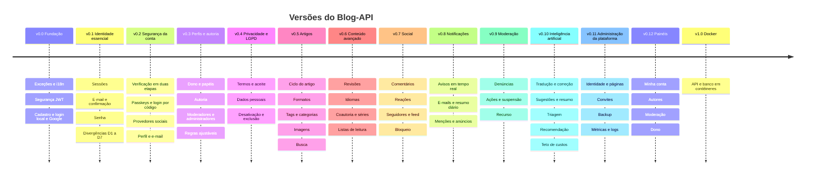

# Roadmap

O Roadmap mostra **para onde o produto vai**: as versões (Milestones) planejadas, o que cada uma entrega, por que estão nessa ordem e o que é preciso para considerar cada uma concluída. O detalhe de cada tarefa fica nas [Issues](https://github.com/barbaraguarino/Blog-API/issues), e o andamento do dia a dia no quadro do GitHub Projects. Como o trabalho é organizado no quadro Kanban está no [Processo_de_Desenvolvimento.md](Processo_de_Desenvolvimento.md).

---

## 1. Visão geral



| Versão | Tema | Situação |
|---|---|---|
| **v0.0 – Fundação** | Base técnica e identidade básica | ✅ Concluída |
| **v0.1 – Identidade essencial** | Contas confiáveis e sessões seguras | ▶️ Próxima |
| **v0.2 – Segurança da conta** | Proteção extra e outras formas de entrar | ⏳ Planejada |
| **v0.3 – Perfis e autoria** | O dono, os papéis e quem pode escrever | ⏳ Planejada |
| **v0.4 – Privacidade e LGPD** | Os direitos de cada pessoa sobre os próprios dados | ⏳ Planejada |
| **v0.5 – Artigos** | Publicar conteúdo organizado | ⏳ Planejada |
| **v0.6 – Conteúdo avançado** | Escrever em equipe e em vários idiomas | ⏳ Planejada |
| **v0.7 – Social** | Interagir com o conteúdo e com as pessoas | ⏳ Planejada |
| **v0.8 – Notificações** | Avisar cada pessoa do que a envolve | ⏳ Planejada |
| **v0.9 – Moderação** | Proteger a comunidade | ⏳ Planejada |
| **v0.10 – Inteligência artificial** | Ajudar quem escreve e quem lê, dentro do teto de custos | ⏳ Planejada |
| **v0.11 – Administração da plataforma** | Dar ao dono o controle da instalação | ⏳ Planejada |
| **v0.12 – Painéis** | Uma visão do próprio trabalho para cada perfil | ⏳ Planejada |
| **v1.0 – Docker** | Executar a API e o banco em contêineres | ⏳ Planejada |

A v1.0 marca o fim do escopo planejado: com ela, todos os requisitos e todas as regras de negócio estão entregues.

---

## 2. Por que esta ordem

1. **Identidade antes de tudo:** todas as outras funcionalidades dependem de saber quem é o usuário. Sessões revogáveis, e-mail confirmado e recuperação de senha são o mínimo para uma conta ser confiável, e por isso a v0.1 também corrige as divergências D1 a D7 das Regras de Negócio.
2. **Verificação em duas etapas antes dos perfis:** o dono configura a verificação em duas etapas no primeiro acesso (RN-054), e moderadores e administradores só usam as funções desses papéis com ela ativa (RN-028). Sem ela, ninguém aprova os pedidos de autoria e, sem autores, não há artigos. Por isso a segurança da conta vem na v0.2 (D-037, que substitui a D-008).
3. **Perfis antes da privacidade:** a plataforma só aceita cadastros depois de o dono publicar os termos de uso, a política de privacidade e o contato do encarregado (RN-127), e o dono só existe a partir da v0.3.
4. **Privacidade antes do conteúdo:** com a consulta, a exportação e a exclusão dos dados prontas na v0.4, cada versão seguinte já nasce incluindo os próprios dados nelas, em vez de adaptá-las no fim.
5. **Conteúdo antes de interação:** só faz sentido comentar, reagir ou seguir quando existem artigos. Por isso os artigos (v0.5 e v0.6) vêm antes do Social (v0.7).
6. **Notificações depois do Social e antes da Moderação:** os avisos precisam de eventos para avisar, como comentários, seguidores e respostas. A moderação, que vem logo depois, já nasce avisando o resultado das denúncias e dos recursos.
7. **Inteligência artificial depois da Moderação:** a recomendação usa os seguidores e as reações, e a triagem usa os comentários e as denúncias. O teto de custos entra junto, porque a IA é o serviço pago cujo uso mais varia.
8. **Administração antes dos Painéis:** o painel do dono reúne o backup, as estatísticas, as métricas e os logs, que são entregues na v0.11.
9. **Docker por último:** a execução em contêineres é a última tarefa do projeto (D-016). Até ela, a API e o banco rodam diretamente na máquina (RNF-039).

---

## 3. Regras que valem para todas as versões

Algumas regras valem em todas as versões e, por isso, não se repetem em cada uma delas:

- os requisitos de base valem desde a primeira linha de código: RNF-001, RNF-002, RNF-003, RNF-005, RNF-008, RNF-025, RNF-026, RNF-029 e RNF-031 a RNF-039;
- cada PR segue a Definição de Pronto, com testes, arquivos `.http`, Swagger e documentos atualizados;
- a partir da v0.3, cada ação administrativa nova entra no registro das ações administrativas (RF-130), e cada valor ⚙️ novo pode ser ajustado pelo dono (RF-119). Até lá, os valores ⚙️ usam o padrão definido na configuração;
- a partir da v0.4, cada dado pessoal novo entra na consulta, na exportação e na exclusão da conta (RF-026 a RF-028), e cada serviço externo novo entra na lista dos serviços que recebem dados (RN-042);
- a partir da v0.8, cada evento novo ganha o seu tipo de aviso (RF-093);
- até a v0.11, o idioma padrão e o fuso horário da plataforma vêm da configuração da API;
- uma versão só é concluída quando todas as suas issues cumprem os critérios de aceite, a suíte completa de testes passa e há um relatório de testes da versão, como manda a seção 7 do [Processo_de_Desenvolvimento.md](Processo_de_Desenvolvimento.md). O item "Concluída quando" de cada versão diz o que precisa funcionar de ponta a ponta.

---

## 4. Versões

### v0.0 – Fundação ✅

- **Objetivo:** criar a base técnica sobre a qual todo o resto é construído.
- **Entregas:**
  - tratamento global de exceções com formato único de erro;
  - internacionalização das mensagens (pt-BR e en);
  - Spring Security stateless com JWT em cookie `HttpOnly`;
  - cadastro com e-mail e senha (BCrypt) e com conta Google;
  - login por e-mail ou nickname, e login com Google.
- **Requisitos:** RF-001 a RF-004, em parte: o aceite dos termos e a idade mínima entram na v0.4.
- **Regras:** RN-001, RN-005, RN-011 e RN-017 e, em parte, RN-003, RN-006, RN-007, RN-008, RN-012 e RN-013.
- **Observação:** feita antes da adoção das Issues. As tarefas #01 a #08 do antigo `Backlog_Sequencial.md` não correspondem a números de issues ou PRs do GitHub.

### v0.1 – Identidade essencial ▶️

- **Objetivo:** tornar as contas confiáveis, com o e-mail comprovado, sessões que podem ser encerradas e a senha recuperável, e alinhar o código atual às Regras de Negócio.
- **Entregas:**
  - documentação da API com Swagger;
  - configurações separadas por ambiente, com a de produção pronta;
  - situações da conta e confirmação do e-mail, com prazo para confirmar;
  - envio de e-mails pelo AWS SES, atrás de um gateway, e códigos temporários;
  - token de renovação com rotação e detecção de reuso;
  - logout, listagem e encerramento de sessões;
  - recuperação de senha e troca de senha com código;
  - respostas que não revelam quais contas existem;
  - limites de tentativas de login, de envio de códigos e de requisições em toda a API;
  - correção das divergências D1 a D7;
  - testes para as classes que ainda não têm.
- **Requisitos:** RF-009 a RF-012 e RF-014 a RF-016 · RNF-004, RNF-006, RNF-007, RNF-013, RNF-015, RNF-027 e RNF-040.
- **Regras:** RN-002, RN-003, RN-006 a RN-008, RN-009 (e-mail não confirmado e ativa), RN-010, RN-012 a RN-014, RN-017 a RN-020, RN-021 (sessões), RN-022 a RN-026 e RN-136.
- **Dependências internas:**
  ```mermaid
  flowchart LR
      RT[Token de renovação] --> SES[Listar e encerrar sessões]
      SIT[Situações da conta] --> ACT[Confirmação do e-mail]
      MAIL[E-mail + códigos] --> ACT
      MAIL --> FORGOT[Recuperação de senha]
      RT --> FORGOT
      MAIL --> CHANGE[Troca de senha]
      SES --> CHANGE
  ```
- **Concluída quando:** uma pessoa conseguir se cadastrar, confirmar o e-mail, entrar, ver e encerrar as próprias sessões e recuperar a senha esquecida, as divergências D1 a D7 estiverem corrigidas e toda classe de produção tiver teste.

### v0.2 – Segurança da conta ⏳

- **Objetivo:** dar proteção extra às contas, oferecer outras formas de entrar e deixar cada pessoa cuidar do próprio perfil.
- **Entregas:**
  - verificação em duas etapas com aplicativo autenticador e códigos de recuperação;
  - dispositivos confiáveis;
  - reautenticação antes de ações sensíveis;
  - passkeys;
  - login com código enviado por e-mail;
  - cadastro e login com GitHub e Apple, e vínculo e desvínculo de provedores sociais;
  - histórico de acessos com local aproximado e alerta de acesso em dispositivo novo;
  - edição do perfil e troca do nickname;
  - troca de e-mail.
- **Requisitos:** RF-005, RF-007, RF-008, RF-013, RF-017 a RF-019, RF-021 a RF-024 e RF-032.
- **Regras:** RN-007, RN-008 e RN-013 (outros provedores), RN-015, RN-016, RN-021 (histórico de acessos), RN-027, RN-029 a RN-033 e RN-040.
- **Concluída quando:** um usuário conseguir ativar a verificação em duas etapas e entrar com o código do aplicativo, entrar com uma passkey, com um código por e-mail e com o GitHub, vincular e desvincular um provedor e receber o alerta ao entrar de um dispositivo novo.

### v0.3 – Perfis e autoria ⏳

- **Objetivo:** criar o dono e os papéis da plataforma e definir quem escreve, quem modera e quem administra.
- **Entregas:**
  - superadministrador criado na primeira subida da API, com a senha definida por código e a verificação em duas etapas;
  - papéis e hierarquia;
  - verificação em duas etapas obrigatória para a moderação e a administração;
  - modos de autoria;
  - pedido, aprovação e retirada de autoria, e nomeação direta no modo fechado;
  - concessão e retirada do papel de moderador;
  - promoção e rebaixamento de administradores;
  - exceções de início;
  - transferência da posse da plataforma;
  - gestão de usuários;
  - ajuste das regras ⚙️, com histórico das mudanças;
  - registro das ações administrativas.
- **Requisitos:** RF-020, RF-035 a RF-045, RF-117, RF-119 e RF-130.
- **Regras:** RN-028, RN-044 a RN-056, RN-130, RN-131 e RN-140.
- **Concluída quando:** o dono conseguir fazer o primeiro acesso, nomear o primeiro moderador e o primeiro administrador, aprovar um pedido de autoria e ajustar um prazo, com tudo guardado no registro das ações administrativas.

### v0.4 – Privacidade e LGPD ⏳

- **Objetivo:** garantir os direitos de cada pessoa sobre os próprios dados e cumprir a LGPD antes de a plataforma aceitar cadastros.
- **Entregas:**
  - contato do encarregado pelos dados pessoais;
  - versões públicas dos termos de uso e da política de privacidade;
  - plataforma pronta para cadastros;
  - aceite dos termos no cadastro e a cada nova versão;
  - idade mínima;
  - escolha dos dados do perfil público;
  - consulta e exportação dos próprios dados;
  - desativação temporária da conta;
  - exclusão da conta com prazo de carência e escolha entre apagar e anonimizar os conteúdos públicos;
  - lista dos serviços externos que recebem dados;
  - mascaramento e retenção dos logs e dos registros de acesso.
- **Requisitos:** RF-006, RF-025 a RF-031, RF-034, RF-047 (termos e política), RF-112 e RF-113 · RNF-016, RNF-019 e RNF-020.
- **Regras:** RN-003 (aceite), RN-004, RN-009 (desativada e com exclusão agendada), RN-034 a RN-039, RN-042, RN-043 (logs e registros de acesso), RN-127 e RN-128.
- **Concluída quando:** um cadastro só for aceito depois de o dono publicar os termos e o contato do encarregado, e um usuário conseguir exportar os próprios dados, desativar a conta e pedir a exclusão, desistindo dela dentro da carência.

### v0.5 – Artigos ⏳

- **Objetivo:** permitir que os autores publiquem conteúdo organizado e que qualquer pessoa o encontre e o leia.
- **Entregas:**
  - criação, rascunho, publicação, arquivamento e exclusão de artigos;
  - agendamento da publicação;
  - conteúdo em Markdown, LaTeX, HTML com CSS ou texto puro, com alinhamento;
  - limpeza do HTML e do CSS e bloqueio de recursos externos;
  - descrições obrigatórias das imagens e das fórmulas;
  - imagens no AWS S3, sem metadados, para a foto de perfil, a capa e o corpo dos artigos;
  - tags e categorias;
  - listagens paginadas, leitura pública, tempo estimado de leitura e busca.
- **Requisitos:** RF-046, RF-050, RF-051, RF-053 a RF-057, RF-066 a RF-068, RF-070 e RF-071 · RNF-009 a RNF-011.
- **Regras:** RN-057 a RN-066 e RN-074 a RN-078.
- **Concluída quando:** um autor conseguir publicar um artigo com capa, imagens descritas, categoria e tags, e um visitante sem login conseguir encontrá-lo pela busca e lê-lo.

### v0.6 – Conteúdo avançado ⏳

- **Objetivo:** permitir escrever em equipe e em vários idiomas e ajudar leitores e autores a organizar o que leem e o que escrevem.
- **Entregas:**
  - histórico de revisões, com comparação e restauração;
  - versões de idioma no mesmo endereço, com a versão certa mostrada a cada leitor e a troca de versão;
  - coautoria, com convite, aceite, saída e aviso de edição simultânea;
  - séries de artigos;
  - link de prévia dos rascunhos;
  - listas de leitura;
  - exportação dos próprios artigos.
- **Requisitos:** RF-048, RF-049, RF-052, RF-058 a RF-065 e RF-069.
- **Regras:** RN-067 a RN-073, RN-079 e RN-080.
- **Concluída quando:** dois coautores conseguirem editar um artigo sem perder alterações, o artigo tiver versões em dois idiomas mostradas conforme o idioma do leitor e o autor conseguir restaurar uma revisão anterior.

### v0.7 – Social ⏳

- **Objetivo:** transformar leitores em comunidade.
- **Entregas:**
  - comentários com respostas, edição, remoção e limite de frequência;
  - fechar, reabrir e fixar comentários;
  - leitura pública dos comentários;
  - reações aos artigos e aos comentários;
  - seguir autores, lista dos autores seguidos e feed;
  - bloqueio entre usuários;
  - perfil público, com os artigos de cada autor.
- **Requisitos:** RF-047 (comentários), RF-082 a RF-084 e RF-086 a RF-092.
- **Regras:** RN-092 a RN-096 e RN-098 a RN-103.
- **Concluída quando:** um leitor conseguir comentar um artigo, reagir, seguir o autor e ver os próximos artigos dele no feed, e um usuário bloqueado não conseguir comentar nos artigos de quem o bloqueou.

### v0.8 – Notificações ⏳

- **Objetivo:** avisar cada pessoa do que a envolve, pelos canais que ela escolher.
- **Entregas:**
  - avisos dentro da plataforma, em tempo real;
  - avisos por e-mail;
  - escolha dos canais para cada tipo de aviso;
  - lista dos avisos e marcação como lidos;
  - agrupamento de avisos e resumo diário por e-mail;
  - menções com @nickname;
  - anúncios do dono;
  - limites de e-mail e reenvio automático dos que falharem;
  - avisos dos eventos das versões anteriores, como pedidos de autoria, comentários, respostas e novos seguidores.
- **Requisitos:** RF-085, RF-093 a RF-097 e RF-132 · RNF-023 (e-mails), RNF-030 e RNF-043.
- **Regras:** RN-097, RN-104 a RN-112 e RN-135.
- **Concluída quando:** um autor receber em tempo real o aviso de um novo comentário, uma pessoa mencionada receber o aviso pelos canais que escolheu e o resumo diário reunir os avisos de quem o pediu.

### v0.9 – Moderação ⏳

- **Objetivo:** manter a comunidade saudável, com decisões justas e revisáveis.
- **Entregas:**
  - denúncias de artigos, comentários e perfis;
  - fila de denúncias, com regra de conflito de interesse;
  - ações de moderação: arquivar a denúncia, ocultar o conteúdo, remover comentários e penalizar o autor;
  - suspensão de contas;
  - resultado da análise para quem denunciou;
  - recurso, analisado por outra pessoa;
  - denúncia procedente contra um moderador;
  - palavras bloqueadas.
- **Requisitos:** RF-098 a RF-102 e RF-118.
- **Regras:** RN-009 (suspensa) e RN-113 a RN-121.
- **Concluída quando:** um conteúdo denunciado puder ser ocultado por um moderador, quem denunciou receber o resultado e o recurso do autor for analisado por outra pessoa.

### v0.10 – Inteligência artificial ⏳

- **Objetivo:** ajudar quem escreve e quem lê, sem passar do teto de custos e sem expor dados pessoais.
- **Entregas:**
  - o modelo de IA atrás de um gateway, protegido contra instruções escondidas no conteúdo;
  - ligar e desligar cada funcionalidade de IA;
  - limites de uso da IA, por usuário e no total;
  - tradução automática, gerada uma vez e reaproveitada;
  - correção e sugestões de texto;
  - sugestão de tags, de categoria e de resumo;
  - descrições sugeridas para imagens e fórmulas;
  - triagem da moderação;
  - tags de interesse, histórico de interesses e recomendação calculada pela própria API (D-035);
  - funcionamento sem a IA;
  - estimativa dos custos, avisos ao dono e pausa dos serviços não essenciais ao atingir o teto.
- **Requisitos:** RF-033, RF-072 a RF-081, RF-123 e RF-124 · RNF-012, RNF-017, RNF-022, RNF-023 (IA), RNF-024, RNF-028 e RNF-042.
- **Regras:** RN-041, RN-081 a RN-091 e RN-137.
- **Concluída quando:** um leitor ler um artigo traduzido para o idioma dele, um autor aceitar parte das correções sugeridas, a triagem ordenar a fila da moderação e, com o teto atingido em um teste, a IA for pausada enquanto a plataforma continua funcionando com o conteúdo original.

### v0.11 – Administração da plataforma ⏳

- **Objetivo:** dar ao dono o controle e a visão da instalação.
- **Entregas:**
  - identidade da plataforma: nome, descrição, logo, idioma padrão, fuso horário e links;
  - páginas institucionais;
  - convites por e-mail;
  - backup diário e manual, criptografado, com download e restauração;
  - modo de manutenção;
  - saúde do sistema;
  - estatísticas de acesso e da comunidade;
  - métricas técnicas, de crescimento, de segurança e de uso da IA e dos e-mails;
  - consulta dos logs.
- **Requisitos:** RF-047 (páginas institucionais), RF-110, RF-111, RF-114 a RF-116, RF-120 a RF-122, RF-125 a RF-129 e RF-131 · RNF-014, RNF-021 e RNF-041.
- **Regras:** RN-043 (backups), RN-125, RN-126, RN-129, RN-132 a RN-134, RN-138 e RN-139.
- **Concluída quando:** o dono conseguir definir a identidade da plataforma, convidar uma pessoa, baixar e restaurar um backup, colocar a plataforma em manutenção e consultar as estatísticas e os logs.

### v0.12 – Painéis ⏳

- **Objetivo:** dar a cada perfil uma visão do próprio trabalho.
- **Entregas:**
  - painel de minha conta, para todo usuário cadastrado;
  - painel do autor, com estatísticas agregadas por artigo e idioma e a contagem anônima de leituras;
  - painel dos autores, com o espaço comum;
  - painel da moderação;
  - painel do moderador;
  - painel do dono.
- **Requisitos:** RF-103 a RF-109 · RNF-018.
- **Regras:** RN-122 a RN-124.
- **Concluída quando:** cada perfil conseguir abrir o próprio painel, nenhum perfil conseguir abrir o painel de outro e nenhuma estatística revelar quem leu um artigo ou reagiu a ele.

### v1.0 – Docker ⏳

- **Objetivo:** executar a API e o banco de dados em contêineres, como a última tarefa do projeto (D-016).
- **Entregas:**
  - imagem Docker da API;
  - Docker Compose com a API e o PostgreSQL;
  - instruções de execução no README.
- **Requisito:** RNF-044.
- **Concluída quando:** a API e o banco subirem com um único comando, a suíte de testes passar e a execução direta na máquina (RNF-039) continuar funcionando.

---

## 5. Depois da v0.4 (ideias, sem compromisso)

Ideias que podem entrar no backlog no futuro, depois de avaliadas:

- perfil de produção e publicação da API;
- Docker e Docker Compose para o ambiente de desenvolvimento;
- notificações (novo comentário, novo seguidor);
- testes de carga;
- painel de métricas da plataforma.

---

## 6. Fluxo de trabalho

1. Toda tarefa nasce como uma **Issue**, com o template de funcionalidade ou de bug.
2. A issue entra em um **Milestone** (versão) e na fila do quadro Kanban do Projects.
3. O trabalho segue o **Git Flow**: um branch `feature/*` ou `bugfix/*` por issue, a partir da `develop`.
4. Cada branch tem **um único PR** para a `develop`, com `Closes #N` e o checklist da Definição de Pronto. A issue só fecha se todos os critérios de aceite forem cumpridos.
5. Ao fechar um Milestone, um branch `release/vX.Y.Z` leva a `develop` para a `main`, junto com um relatório de testes.

O processo completo está em [Processo_de_Desenvolvimento.md](Processo_de_Desenvolvimento.md), e as decisões em [Decisões.md](Decisões.md).
