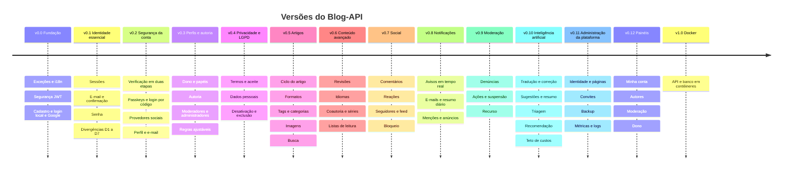

# Roadmap

O Roadmap mostra **para onde o produto vai**: as versões (Milestones) planejadas, o que cada uma entrega, por que estão nessa ordem e o que é preciso para considerar cada uma concluída. O detalhe de cada tarefa fica nas [Issues](https://github.com/barbaraguarino/Blog-API/issues), e o andamento do dia a dia no quadro do GitHub Projects. Como o trabalho é organizado no quadro Kanban está no [Processo_de_Desenvolvimento.md](Processo_de_Desenvolvimento.md).

---

## 1. Visão geral



| Versão | Tema | Situação |
|---|---|---|
| **v0.0 – Fundação** | Base técnica e identidade básica | ✅ Concluída |
| **v0.1 – Identidade essencial** | Contas confiáveis e sessões seguras | ▶️ Próxima |
| **v0.2 – Segurança da conta** | Proteção extra e outras formas de entrar | ⏳ Planejada |
| **v0.3 – Perfis e autoria** | O dono, os papéis e quem pode escrever | ⏳ Planejada |
| **v0.4 – Privacidade e LGPD** | Os direitos de cada pessoa sobre os próprios dados | ⏳ Planejada |
| **v0.5 – Artigos** | Publicar conteúdo organizado | ⏳ Planejada |
| **v0.6 – Conteúdo avançado** | Escrever em equipe e em vários idiomas | ⏳ Planejada |
| **v0.7 – Social** | Interagir com o conteúdo e com as pessoas | ⏳ Planejada |
| **v0.8 – Notificações** | Avisar cada pessoa do que a envolve | ⏳ Planejada |
| **v0.9 – Moderação** | Proteger a comunidade | ⏳ Planejada |
| **v0.10 – Inteligência artificial** | Ajudar quem escreve e quem lê, dentro do teto de custos | ⏳ Planejada |
| **v0.11 – Administração da plataforma** | Dar ao dono o controle da instalação | ⏳ Planejada |
| **v0.12 – Painéis** | Uma visão do próprio trabalho para cada perfil | ⏳ Planejada |
| **v1.0 – Docker** | Executar a API e o banco em contêineres | ⏳ Planejada |

A v1.0 marca o fim do escopo planejado: com ela, todos os requisitos e todas as regras de negócio estão entregues.

---

## 2. Por que esta ordem

1. **Identidade antes de tudo:** todas as outras funcionalidades dependem de saber quem é o usuário. Sessões revogáveis, e-mail confirmado e recuperação de senha são o mínimo para uma conta ser confiável, e por isso a v0.1 também corrige as divergências D1 a D7 das Regras de Negócio.
2. **Verificação em duas etapas antes dos perfis:** o dono configura a verificação em duas etapas no primeiro acesso (RN-054), e moderadores e administradores só usam as funções desses papéis com ela ativa (RN-028). Sem ela, ninguém aprova os pedidos de autoria e, sem autores, não há artigos. Por isso a segurança da conta vem na v0.2 (D-037, que substitui a D-008).
3. **Perfis antes da privacidade:** a plataforma só aceita cadastros depois de o dono publicar os termos de uso, a política de privacidade e o contato do encarregado (RN-127), e o dono só existe a partir da v0.3.
4. **Privacidade antes do conteúdo:** com a consulta, a exportação e a exclusão dos dados prontas na v0.4, cada versão seguinte já nasce incluindo os próprios dados nelas, em vez de adaptá-las no fim.
5. **Conteúdo antes de interação:** só faz sentido comentar, reagir ou seguir quando existem artigos. Por isso os artigos (v0.5 e v0.6) vêm antes do Social (v0.7).
6. **Notificações depois do Social e antes da Moderação:** os avisos precisam de eventos para avisar, como comentários, seguidores e respostas. A moderação, que vem logo depois, já nasce avisando o resultado das denúncias e dos recursos.
7. **Inteligência artificial depois da Moderação:** a recomendação usa os seguidores e as reações, e a triagem usa os comentários e as denúncias. O teto de custos entra junto, porque a IA é o serviço pago cujo uso mais varia.
8. **Administração antes dos Painéis:** o painel do dono reúne o backup, as estatísticas, as métricas e os logs, que são entregues na v0.11.
9. **Docker por último:** a execução em contêineres é a última tarefa do projeto (D-016). Até ela, a API e o banco rodam diretamente na máquina (RNF-039).

---

## 3. Versões

### v0.0 – Fundação ✅

- **Objetivo:** criar a base técnica sobre a qual todo o resto é construído.
- **Entregas:**
  - tratamento global de exceções com formato único de erro;
  - internacionalização das mensagens (pt-BR e en);
  - Spring Security stateless com JWT em cookie `HttpOnly`;
  - cadastro com e-mail e senha (BCrypt) e com conta Google;
  - login por e-mail ou nickname, e login com Google.
- **Requisitos:** RF-001, RF-002, RF-003 e RF-004.
- **Observação:** feita antes da adoção das Issues. As tarefas #01 a #08 do antigo `Backlog_Sequencial.md` não correspondem a números de issues ou PRs do GitHub.

### v0.1 – Identidade essencial ▶️

- **Objetivo:** tornar as contas confiáveis. O e-mail passa a ser comprovado, as sessões podem ser revogadas e a senha pode ser recuperada.
- **Entregas:**
  - documentação da API com Swagger;
  - Refresh Token com rotação e detecção de reuso;
  - listagem e revogação de sessões;
  - infraestrutura de e-mail e códigos temporários;
  - ativação de conta;
  - recuperação de senha e troca de senha com código;
  - correção das divergências D1 a D5;
  - testes para as classes que ainda não têm.
- **Requisitos:** RF-010, RF-011, RF-012, RF-014, RF-015 e RF-016 · RNF-004, RNF-006, RNF-007, RNF-027, RNF-033.
- **Dependências internas:**
  ```mermaid
  flowchart LR
      RT[Refresh Token] --> SES[Listar e revogar sessões]
      MAIL[E-mail + códigos] --> ACT[Ativação de conta]
      MAIL --> FORGOT[Recuperação de senha]
      RT --> FORGOT
      MAIL --> CHANGE[Troca de senha]
      SES --> CHANGE
  ```
- **Concluída quando:** todas as issues do Milestone fecharem com os critérios de aceite cumpridos, a suíte completa passar, o Swagger documentar todos os endpoints e houver um relatório de testes da versão.

### v0.2 – Artigos (MVP) ⏳

- **Objetivo:** permitir que autores aprovados publiquem conteúdo organizado.
- **Entregas:**
  - pedido e aprovação de autoria;
  - categorias em árvore;
  - artigos com rascunho, publicação e arquivamento;
  - tags;
  - upload de avatar e capa no AWS S3;
  - listagens paginadas.
- **Requisitos:** RF-036, RF-037, RF-053, RF-066, RF-067 e RF-070 · RNF-029.
- **Novo na arquitetura:** módulo `article`, `StorageGateway` e autorização por papel com `@PreAuthorize`.
- **Concluída quando:** um autor aprovado conseguir publicar um artigo com capa, categoria e tags, e um visitante conseguir lê-lo nas listagens públicas.

### v0.3 – Social ⏳

- **Objetivo:** transformar leitores em comunidade.
- **Entregas:** comentários com respostas, reações, seguidores, feed e busca de artigos.
- **Requisitos:** RF-050, RF-082, RF-086, RF-088 e RF-090.
- **Novo na arquitetura:** módulo `social` e busca textual no PostgreSQL.
- **Concluída quando:** um leitor conseguir encontrar um artigo pela busca, comentá-lo, reagir, seguir o autor e ver os próximos artigos dele no feed.

### v0.4 – Moderação e segurança avançada ⏳

- **Objetivo:** manter a comunidade saudável e oferecer proteção extra às contas.
- **Entregas:** denúncias, painel de moderação com ações e registro, 2FA com app autenticador e vínculo e desvínculo de conta Google.
- **Requisitos:** RF-017, RF-022, RF-098, RF-099.
- **Novo na arquitetura:** módulo `moderation` e segundo fator no fluxo de login.
- **Concluída quando:** um conteúdo denunciado puder ser ocultado por um moderador, e um usuário conseguir entrar exigindo o código do app autenticador.

---

## 4. Depois da v0.4 (ideias, sem compromisso)

Ideias que podem entrar no backlog no futuro, depois de avaliadas:

- perfil de produção e publicação da API;
- Docker e Docker Compose para o ambiente de desenvolvimento;
- notificações (novo comentário, novo seguidor);
- testes de carga;
- painel de métricas da plataforma.

---

## 5. Fluxo de trabalho

1. Toda tarefa nasce como uma **Issue**, com o template de funcionalidade ou de bug.
2. A issue entra em um **Milestone** (versão) e na fila do quadro Kanban do Projects.
3. O trabalho segue o **Git Flow**: um branch `feature/*` ou `bugfix/*` por issue, a partir da `develop`.
4. Cada branch tem **um único PR** para a `develop`, com `Closes #N` e o checklist da Definição de Pronto. A issue só fecha se todos os critérios de aceite forem cumpridos.
5. Ao fechar um Milestone, um branch `release/vX.Y.Z` leva a `develop` para a `main`, junto com um relatório de testes.

O processo completo está em [Processo_de_Desenvolvimento.md](Processo_de_Desenvolvimento.md), e as decisões em [Decisões.md](Decisões.md).
