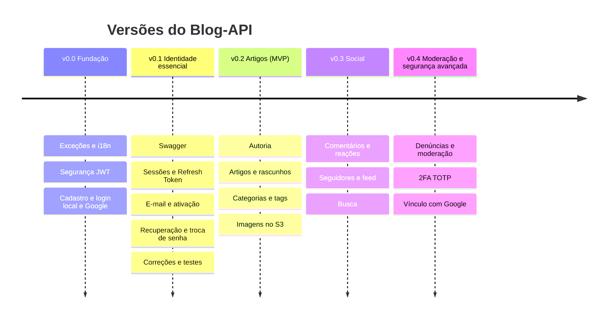

# Roadmap

O Roadmap mostra **para onde o produto vai**: as versões (Milestones) planejadas, o que cada uma entrega, por que estão nessa ordem e o que é preciso para considerar cada uma concluída. O detalhe de cada tarefa fica nas [Issues](https://github.com/barbaraguarino/Blog-API/issues), e o andamento do dia a dia no quadro do GitHub Projects. Como o trabalho é organizado no quadro Kanban está no [Processo_de_Desenvolvimento.md](Processo_de_Desenvolvimento.md).

---

## 1. Visão geral



| Versão | Tema | Situação |
|---|---|---|
| **v0.0 – Fundação** | Base técnica e identidade básica | ✅ Concluída |
| [**v0.1 – Identidade essencial**](https://github.com/barbaraguarino/Blog-API/milestone/1) | Contas e sessões seguras | ▶️ Próxima |
| [**v0.2 – Artigos (MVP)**](https://github.com/barbaraguarino/Blog-API/milestone/2) | Publicar conteúdo | ⏳ Planejada |
| [**v0.3 – Social**](https://github.com/barbaraguarino/Blog-API/milestone/3) | Interagir com o conteúdo | ⏳ Planejada |
| [**v0.4 – Moderação e segurança avançada**](https://github.com/barbaraguarino/Blog-API/milestone/4) | Proteger a comunidade | ⏳ Planejada |

---

## 2. Por que esta ordem

1. **Identidade antes de tudo:** todas as outras funcionalidades dependem de saber quem é o usuário. Sessões revogáveis, e-mail verificado e recuperação de senha são o mínimo para uma conta ser confiável.
2. **Conteúdo antes de interação:** só faz sentido comentar, reagir ou seguir quando existem artigos. Por isso a v0.2 (artigos) vem antes da v0.3 (social).
3. **Moderação depois da comunidade:** a moderação trata o conteúdo e as interações. Ela vem quando ambos existem.
4. **Segurança avançada por último:** a 2FA com app autenticador e o vínculo com Google melhoram uma base que já funciona. Eles foram movidos para a v0.4 para que o núcleo do blog fosse entregue antes (D-008).

---

## 3. Versões

### v0.0 – Fundação ✅

- **Objetivo:** criar a base técnica sobre a qual todo o resto é construído.
- **Entregas:**
  - tratamento global de exceções com formato único de erro;
  - internacionalização das mensagens (pt-BR e en);
  - Spring Security stateless com JWT em cookie `HttpOnly`;
  - cadastro com e-mail e senha (BCrypt) e com conta Google;
  - login por e-mail ou nickname, e login com Google.
- **Requisitos:** RF-001, RF-002, RF-003 e RF-004.
- **Observação:** feita antes da adoção das Issues. As tarefas #01 a #08 do antigo `Backlog_Sequencial.md` não correspondem a números de issues ou PRs do GitHub.

### v0.1 – Identidade essencial ▶️

- **Objetivo:** tornar as contas confiáveis. O e-mail passa a ser comprovado, as sessões podem ser revogadas e a senha pode ser recuperada.
- **Entregas:**
  - documentação da API com Swagger;
  - Refresh Token com rotação e detecção de reuso;
  - listagem e revogação de sessões;
  - infraestrutura de e-mail e códigos temporários;
  - ativação de conta;
  - recuperação de senha e troca de senha com código;
  - correção das divergências D1 a D5;
  - testes para as classes que ainda não têm.
- **Requisitos:** RF-009, RF-010, RF-011, RF-013, RF-014 e RF-015 · RNF-004, RNF-006, RNF-007, RNF-020, RNF-026.
- **Dependências internas:**
  ```mermaid
  flowchart LR
      RT[Refresh Token] --> SES[Listar e revogar sessões]
      MAIL[E-mail + códigos] --> ACT[Ativação de conta]
      MAIL --> FORGOT[Recuperação de senha]
      RT --> FORGOT
      MAIL --> CHANGE[Troca de senha]
      SES --> CHANGE
  ```
- **Concluída quando:** todas as issues do Milestone fecharem com os critérios de aceite cumpridos, a suíte completa passar, o Swagger documentar todos os endpoints e houver um relatório de testes da versão.

### v0.2 – Artigos (MVP) ⏳

- **Objetivo:** permitir que autores aprovados publiquem conteúdo organizado.
- **Entregas:**
  - pedido e aprovação de autoria;
  - categorias em árvore;
  - artigos com rascunho, publicação e arquivamento;
  - tags;
  - upload de avatar e capa no AWS S3;
  - listagens paginadas.
- **Requisitos:** RF-034, RF-035, RF-048, RF-056, RF-057 e RF-059 · RNF-022.
- **Novo na arquitetura:** módulo `article`, `StorageGateway` e autorização por papel com `@PreAuthorize`.
- **Concluída quando:** um autor aprovado conseguir publicar um artigo com capa, categoria e tags, e um visitante conseguir lê-lo nas listagens públicas.

### v0.3 – Social ⏳

- **Objetivo:** transformar leitores em comunidade.
- **Entregas:** comentários com respostas, reações, seguidores, feed e busca de artigos.
- **Requisitos:** RF-045, RF-069, RF-073, RF-075 e RF-076.
- **Novo na arquitetura:** módulo `social` e busca textual no PostgreSQL.
- **Concluída quando:** um leitor conseguir encontrar um artigo pela busca, comentá-lo, reagir, seguir o autor e ver os próximos artigos dele no feed.

### v0.4 – Moderação e segurança avançada ⏳

- **Objetivo:** manter a comunidade saudável e oferecer proteção extra às contas.
- **Entregas:** denúncias, painel de moderação com ações e registro, 2FA com app autenticador e vínculo e desvínculo de conta Google.
- **Requisitos:** RF-016, RF-021, RF-084, RF-085.
- **Novo na arquitetura:** módulo `moderation` e segundo fator no fluxo de login.
- **Concluída quando:** um conteúdo denunciado puder ser ocultado por um moderador, e um usuário conseguir entrar exigindo o código do app autenticador.

---

## 4. Depois da v0.4 (ideias, sem compromisso)

Ideias que podem entrar no backlog no futuro, depois de avaliadas:

- perfil de produção e publicação da API;
- Docker e Docker Compose para o ambiente de desenvolvimento;
- notificações (novo comentário, novo seguidor);
- testes de carga;
- painel de métricas da plataforma.

---

## 5. Fluxo de trabalho

1. Toda tarefa nasce como uma **Issue**, com o template de funcionalidade ou de bug.
2. A issue entra em um **Milestone** (versão) e na fila do quadro Kanban do Projects.
3. O trabalho segue o **Git Flow**: um branch `feature/*` ou `bugfix/*` por issue, a partir da `develop`.
4. Cada branch tem **um único PR** para a `develop`, com `Closes #N` e o checklist da Definição de Pronto. A issue só fecha se todos os critérios de aceite forem cumpridos.
5. Ao fechar um Milestone, um branch `release/vX.Y.Z` leva a `develop` para a `main`, junto com um relatório de testes.

O processo completo está em [Processo_de_Desenvolvimento.md](Processo_de_Desenvolvimento.md), e as decisões em [Decisões.md](Decisões.md).
