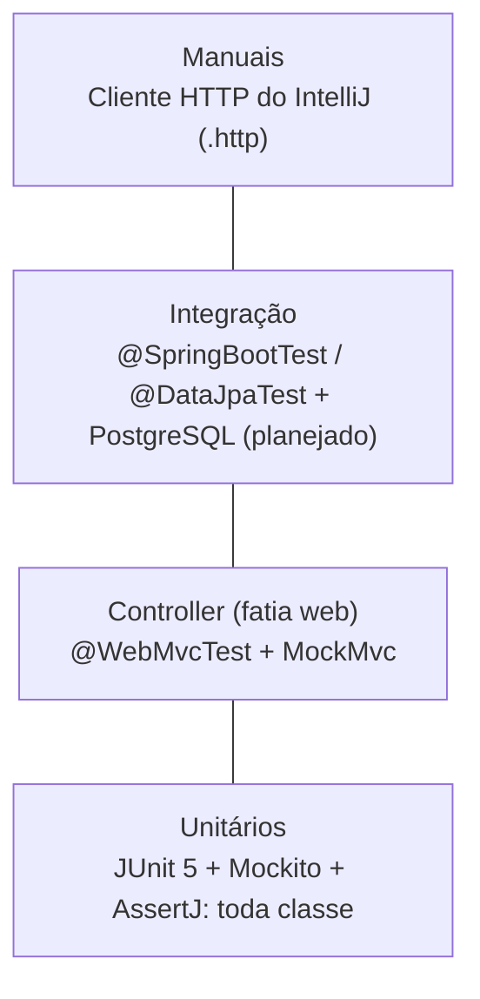

# Plano de Testes

## 1. Objetivo

Este plano define **como o Blog-API é verificado**: quais tipos de teste existem, o que cada um cobre, onde ficam, quando são obrigatórios, como são escritos e executados e como os resultados são registrados. O objetivo é garantir que:

1. cada **regra de negócio** ([Regras_de_Negócio.md](../Regras_de_Negócio.md)) funcione como especificado;
2. cada **endpoint** responda com o status, o formato e as mensagens corretas;
3. **mudanças futuras** não quebrem o que já funciona (testes de regressão);
4. exista **evidência** da qualidade de cada versão entregue (relatórios de testes).

---

## 2. Escopo

### 2.1 O que é testado
- **Todas as classes de produção:** entidades, enums, DTOs, mappers, casos de uso, controllers, exceções, componentes de segurança, gateways e configurações com lógica.
- **Contrato HTTP:** status, cabeçalhos (inclusive cookies), corpo e formato de erro.
- **Segurança:** rotas públicas e protegidas, papéis, emissão e validação do token.
- **Internacionalização:** a tradução das mensagens pelas chaves.
- **Banco de dados** *(quando houver banco de teste)*: migrations e consultas próprias dos repositórios.

### 2.2 O que não é testado (por enquanto)
| Item | Motivo |
|---|---|
| Testes de carga e desempenho | Fora do objetivo atual; reavaliar após a v0.3. |
| Testes de interface | Não há front-end. |
| Serviços reais do Google, e-mail e AWS | Instáveis e externos: são sempre **simulados** com Mockito. |

---

## 3. Estratégia: a pirâmide de testes



A base da pirâmide é a mais numerosa e a mais rápida: **toda classe tem teste unitário**. Acima dela ficam os testes de controller, que verificam o contrato HTTP com a configuração real de segurança. Os testes de integração serão poucos e focados em banco e fluxos completos. Os testes manuais confirmam o comportamento como um cliente veria.

---

## 4. Tipos de teste

### 4.1 Unitário (toda classe)
- **Objetivo:** verificar o comportamento de uma classe isolada.
- **Ferramentas:** JUnit 5, AssertJ e, quando há dependências, Mockito.
- **Exemplos do que testar:**

  | Classe | O que verificar |
  |---|---|
  | `User` | Estado inicial das fábricas (papel, ativo, desbloqueado), geração de nickname (formato, limite de 40, sufixo), `isLinkedToGoogle`. |
  | `UserRole` | Valor `ROLE_*` de cada papel. |
  | DTOs de entrada | Cada validação, usando um `Validator` do Bean Validation, e a chave de i18n de cada violação. |
  | `UserMapper` | Conversão de cada campo e o retorno nulo para entrada nula. |
  | Exceções | Chave e argumentos guardados, causa preservada nas de infraestrutura. |
  | `TokenService` | Token gerado é validado; token adulterado, expirado ou de outro emissor devolve vazio. |
  | `CustomUserDetailsService` | Busca por e-mail quando há `@`, por nickname quando não há, e erro quando não encontra. |

### 4.2 Caso de uso
- **Objetivo:** verificar cada **regra de negócio** do caso de uso.
- **Ferramentas:** `@ExtendWith(MockitoExtension.class)`, `@Mock` para repositórios e gateways, `@InjectMocks` para o caso de uso, e AssertJ.
- **Cobertura mínima:** o caminho feliz e **cada** exceção que o caso de uso pode lançar. Também o que **não** deve acontecer, por exemplo `verify(repository, never()).save(any())` quando o e-mail já existe.

### 4.3 Controller (fatia web)
- **Objetivo:** verificar o contrato HTTP sem subir a aplicação inteira.
- **Ferramentas:** `@WebMvcTest(Controller.class)`, `MockMvc`, `@Import(SecurityConfig.class)` para usar a segurança real e `@MockitoBean` para os casos de uso e componentes de segurança.
- **Cenários obrigatórios por endpoint:**
  - sucesso (status, corpo e, no login, o cabeçalho `Set-Cookie`);
  - DTO inválido → `400` com `validationErrors`;
  - corpo ausente ou malformado → `400`;
  - cada erro de negócio que o endpoint pode devolver (`401`, `403`, `404`, `409`, `422`);
  - rota protegida acessada sem autenticação → `403`.

### 4.4 Exceções e `GlobalExceptionHandler`
- **Objetivo:** garantir que cada exceção vire o status correto, com a mensagem traduzida e no formato `ErrorResponseDTO`.
- **Como:** um controller de teste que lança cada exceção, ou chamadas diretas ao handler com um `MessageSource` real, testando os idiomas `pt-BR` e `en`.

### 4.5 Integração *(planejado)*
- **Objetivo:** verificar migrations, consultas JPA e fluxos completos, como cadastro → login → acesso.
- **Ferramentas:** `@SpringBootTest` ou `@DataJpaTest` com um PostgreSQL de teste e um `application-test.properties` próprio.
- **Convenção:** sufixo `IT` (ex. `RegistrationFlowIT`).

### 4.6 Manual (Cliente HTTP do IntelliJ)
- **Objetivo:** validar o comportamento como um cliente real, na Sprint Review e antes de cada PR.
- **Ferramenta:** o **Cliente HTTP do IntelliJ**, com arquivos `.http`. O projeto **não** usa Postman nem similares.
- **Organização:**
  - os arquivos ficam em `requests/<modulo>/<funcionalidade>/`, com um bloco `###` por cenário e o status esperado no título (ex. `### Cadastrar Usuário Já Cadastrado (Conflito)`);
  - cada requisição traz `Content-Type` e `Accept-Language`;
  - só dados fictícios; tokens como variáveis (`{{token}}`) em `http-client.private.env.json`, que fica fora do Git.

---

## 5. Organização dos testes

### 5.1 Uma classe, uma classe de teste, no mesmo pacote
Para cada classe de produção existe uma classe de teste com **o mesmo nome + `Test`**, **no mesmo pacote**. O caminho do teste é o caminho da classe trocando `src/main` por `src/test`:

```text
src/main/java/br/com/blog/modules/user/presentation/controllers/auth/AuthController.java
src/test/java/br/com/blog/modules/user/presentation/controllers/auth/AuthControllerTest.java
```

**Por que no mesmo pacote:**
- o IntelliJ encontra o par automaticamente (*Go to Test*);
- o teste enxerga membros *package-private* sem precisar torná-los públicos;
- não há dúvida sobre onde criar um teste novo.

### 5.2 Estrutura atual

```text
src/test/java/br/com/blog/
├── BlogApiApplicationTests.java                 # contexto completo (precisa do banco)
└── modules/user/
    ├── application/usecases/auth/               # AuthenticateLocalUserServiceTest, AuthenticateGoogleUserServiceTest
    ├── application/usecases/registration/       # RegisterLocalUserServiceTest, RegisterGoogleUserServiceTest
    └── presentation/controllers/
        ├── auth/AuthControllerTest
        └── registration/UserRegistrationControllerTest
```

### 5.3 Apoio aos testes
- **Fixtures:** fábricas de objetos de teste (ex. um `User` com id e datas preenchidos) ficam em `src/test/java/br/com/blog/support/` e evitam repetir `ReflectionTestUtils` em cada teste.
- **Configuração de teste:** um `src/test/resources/application-test.properties` *(planejado)* separa a configuração de teste da de desenvolvimento.

---

## 6. Padrões de escrita

| Padrão | Regra |
|---|---|
| **Nome do teste** | `@DisplayName` em português, descrevendo o comportamento esperado: "Deve retornar 409 quando o e-mail já existir". |
| **Agrupamento** | `@Nested` por endpoint, caso de uso ou cenário ("Cadastro com e-mail e senha", "Cadastro com a conta Google"). |
| **Estrutura** | *Arrange / Act / Assert*: preparar, executar e verificar, com **um comportamento por teste**. |
| **Asserções** | AssertJ (`assertThat(...)`) para objetos, e `jsonPath` e `header` do MockMvc para respostas. |
| **Rastreabilidade** | Testes de regra citam o ID: `@DisplayName("RN-005: deve gerar nickname em minúsculas com sufixo de 4 dígitos")`. |
| **Isolamento** | Nada de serviços externos reais. Um teste não depende da ordem nem do resultado de outro. |
| **Dados** | Valores fictícios, nunca tokens ou senhas reais. |

---

## 7. Critérios

### 7.1 Quando um teste é obrigatório
- **Toda classe de produção** tem uma classe de teste unitário, mesmo as mais simples.
- **Cada tipo de classe** tem também os testes do seu tipo (seção 4).
- **Toda regra de negócio implementada** tem pelo menos um teste que a cita.
- **Todo endpoint** tem testes de controller e um arquivo `.http` com os cenários de sucesso e de erro.
- **Todo bug corrigido** ganha um teste que falhava antes da correção.

### 7.2 Entrada (para começar a testar uma issue)
- A issue tem critérios de aceite escritos (Definição de Preparado).
- As regras de negócio dela estão registradas no [Regras_de_Negócio.md](../Regras_de_Negócio.md).

### 7.3 Saída (para considerar a issue pronta)
- Todos os testes passam (`./mvnw test` ou pelo IntelliJ).
- Todos os critérios de aceite estão cobertos por teste automatizado ou validados via `.http`.
- Nenhum teste está desativado (`@Disabled`) sem uma issue explicando o motivo.
- A matriz e a cobertura deste plano estão atualizadas.

---

## 8. Matriz de rastreabilidade

| Regra | Coberta por | Situação |
|---|---|---|
| RN-001 e-mail único | `RegisterLocalUserServiceTest`, `RegisterGoogleUserServiceTest`, `UserRegistrationControllerTest` | ✅ |
| RN-002 dados obrigatórios e limites | `UserRegistrationControllerTest` (DTO inválido, genérico) | 🟡 falta testar cada limite |
| RN-003 estado inicial | — | ⬜ teste de domínio do `User` |
| RN-004 política de senha | `UserRegistrationControllerTest` (genérico) | 🟡 falta testar cada exigência |
| RN-005 nickname | — | ⬜ teste de domínio do `User` |
| RN-006 cadastro Google | `RegisterGoogleUserServiceTest`, `UserRegistrationControllerTest` | ✅ |
| RN-007 Google único | `RegisterGoogleUserServiceTest`, `UserRegistrationControllerTest` | ✅ |
| RN-008 JWT em cookie | `AuthControllerTest` | ✅ (falta o `TokenService`) |
| RN-009 login por e-mail ou nickname | `AuthenticateLocalUserServiceTest`, `AuthControllerTest` | 🟡 falta o `CustomUserDetailsService` e o 403 de conta inativa |
| RN-010 login Google | `AuthenticateGoogleUserServiceTest`, `AuthControllerTest` | ✅ (D3 sem teste) |

---

## 9. Cobertura por classe (2026-11-15)

Pela regra "toda classe tem teste", **6 de 35 classes** de produção têm teste. As que faltam:

| Área | Classes sem teste |
|---|---|
| Domínio | `User`, `UserRole` |
| DTOs | `RegisterUserRequestDTO`, `LoginRequestDTO`, `GoogleAuthRequestDTO`, `UserProfileResponseDTO`, `AuthResultDTO`, `GoogleUserInfoDTO` |
| Mapper | `UserMapper` |
| Exceções | `GlobalExceptionHandler`, `ErrorResponseDTO`, `DomainException`, `BusinessRuleException`, `ResourceNotFoundException`, `ResourceAlreadyExistsException`, `InfrastructureException`, `ExternalProviderAuthException`, `SecurityInfrastructureException` |
| Segurança | `SecurityConfig`, `SecurityFilter`, `TokenService`, `CustomUserDetails`, `CustomUserDetailsService` |
| Infraestrutura | `GoogleAuthGateway`, `GoogleAuthConfig`, `UserRepository` (integração) |
| Configuração | `I18nConfiguration`, `BlogApiApplication` (coberta pelo `BlogApiApplicationTests`, que exige banco) |

---

## 10. Ambiente e execução

| Item | Detalhe |
|---|---|
| **Java** | 25 |
| **Build** | Maven Wrapper (`./mvnw test`, ou `.\mvnw.cmd test` no PowerShell) ou o botão *Run Tests* do IntelliJ. |
| **Banco** | Os testes unitários e de controller **não** precisam de banco. O `BlogApiApplicationTests` (`contextLoads`) sobe o contexto completo e precisa do PostgreSQL e do `.env`. |
| **Dependências** | Só as do `pom.xml`, baixadas da Maven Central. Nada é instalado sem aprovação. |
| **Automação** *(planejado)* | Um workflow do GitHub Actions rodando `./mvnw test` em todo PR para a `develop`. |

---

## 11. Gestão de defeitos

1. Um defeito encontrado vira uma **issue `type:bug`** (template de bug), com como reproduzir, o resultado obtido e o esperado.
2. Se o defeito contraria uma regra de negócio, ele é listado em *Divergências conhecidas* no [Regras_de_Negócio.md](../Regras_de_Negócio.md).
3. A correção sai em um branch `bugfix/<nome>` e **começa por um teste que reproduz o defeito** (que falha), seguido da correção (que faz o teste passar).
4. Ao mergear, a divergência sai da lista e a matriz deste plano é atualizada.

---

## 12. Relatórios

- A cada fechamento de Milestone, e sempre que houver uma mudança relevante, é registrado um relatório em [`Relatórios/`](Relatórios/README.md), com o modelo definido lá.
- Os relatórios são datados (`AAAA-MM-DD_Contexto.md`) e nunca editados depois de publicados: um resultado novo gera um relatório novo.
